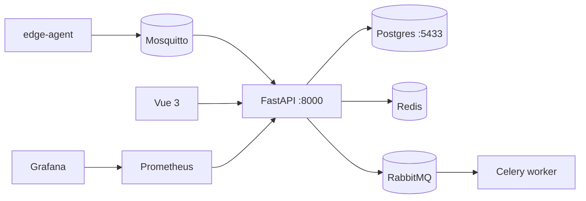

# EdgePilot

面向工业视觉、IoT 与边缘计算场景的统一 AI Agent 管理、工作流编排与可观测平台。
本仓库交付 P0–P7，并在其之上交付 Vision Center（YOLO11n 真实视频推理）：
事件接入、六类 Agent 协作、工作流 DSL/审批、Prompt 版本管理、
Trace/Span 全链路追踪、LLM/工具/RAG 观测、离线部署与数据保留。

> 演示账号、模拟事件与 Mock LLM 输出均显式标记为模拟；不访问外网、不控制真实设备。
> 视觉识别使用**真实 YOLO11n 推理**，只做预训练模型推理，不使用 Mock 检测结果兜底。

## 5 分钟跑通

前置：Docker Desktop（Linux 容器）、Python 3.11（安装
`backend/requirements.txt`）、Node.js 22 + npm。

```bash
# 1) 启动基础服务并迁移
cp -n docker/compose/.env.example docker/compose/.env
docker compose -f docker/compose/docker-compose.yml --profile app up -d \
  postgres redis rabbitmq mosquitto
docker compose -f docker/compose/docker-compose.yml --profile app run --rm api \
  alembic upgrade head
docker compose -f docker/compose/docker-compose.yml --profile app up -d --build

# 2) 初始化演示账号与数据（幂等）
export SEED_PASSWORD='edgepilot-demo'
python backend/scripts/seed_users.py
python backend/scripts/seed_demo.py
python backend/scripts/seed_workflow_demo.py --run

# 3) 启动前端
cd web && npm ci && npm run dev
```

打开 http://127.0.0.1:5173 ，使用 `admin@edgepilot.local` /
`edgepilot-demo` 登录。API 文档在 http://127.0.0.1:8000/docs 。

首次 `npm ci` 与镜像构建会超过 5 分钟；已缓存依赖时按上述步骤可直接跑通。
Windows Git Bash 下若 `make` 不可用，使用上面的 compose 命令即可。

### 快速验证

- 「工作流」→「园区周界巡检（演示）」：查看 DSL、校验、版本；
- 「运行追踪」：打开 seed 产生的运行，审批/查看报告与节点耗时；
- 「AI Observability → Trace 查询」：打开 trace，查看 span 树与 10 个 Inspector
  Tab（LLM/工具/检索/事件/错误/原始 JSON 等）；
- 「AI Observability → 概览」：指标卡与趋势；成本缺失时显示覆盖比例；
- 「提示词 → Playground」：变量渲染、版本对比、执行记录。

## 功能范围

| 领域 | 已交付 |
|---|---|
| 平台底座 | FastAPI 模块化单体、Celery worker/beat、Postgres+pgvector、Redis、RabbitMQ、Mosquitto |
| 多租户与权限 | admin/operator/viewer、JWT + refresh、租户隔离（跨租户 404）、审计日志 |
| 边缘接入 | 节点注册/5s 心跳/离线扫描、设备、事件、MQTT 下行命令、SQLite outbox 断网补发 |
| Agent | Supervisor + device/vision/diagnosis/operations/report 六类角色、发布版本、试跑 |
| 工作流 | DSL 校验、草稿/发布不可变版本、条件/审批/结束节点、Celery 执行与审批恢复 |
| 知识库 | 文档解析/分块、pgvector + 全文/trigram 混合检索、重排 |
| 可观测 | Trace/Span/Event、SSE、10 个 Inspector Tab、8 个观测页面、Analytics SQL 聚合 |
| 视觉识别 | 预训练 YOLO11n 真实推理、任务进度、签名视频播放 + 目标框、事件生成、工作流/Agent 研判联动、模型许可登记 |
| LLM/工具/RAG 观测 | token/耗时/成本（缺失即不可用）、工具权限/重试/错误、检索记录、LangGraph 回调 |
| Prompt | 模板/不可变版本、发布/回滚、Playground、版本对比、执行记录 |
| 运维 | Prometheus `/metrics`、Grafana 看板（observability profile）、保留清理、离线包 |
| 安全 | 密钥 Fernet 加密、日志脱敏、采集模式 OFF/METADATA/REDACTED/FULL、观测故障隔离 |

## 视觉识别（Vision Center）

**模块定位**：把「上传视频 → 真实 YOLO11n 推理 → 播放器叠加目标框 → 事件/任务
查询 → 工作流或 Agent 研判」做成一条可在本地或单机离线环境运行的闭环。后端
只保存任务汇总、结果指针与事件；帧级结果在 artifact JSON 中，视频文件在共享
存储卷中，均不入库。

**真实推理边界**：

- 只使用 Ultralytics 预训练 `yolo11n` 权重做检测；**不做训练、微调、优化、导出**，
  默认 CPU 推理，GPU 不是运行前提。
- 框与置信度来自真实推理；推理服务不可达、权重缺失或结果文件损坏时，请求明确
  失败（如 `vision_service_unavailable`、`artifact_corrupted`）或模型报
  `degraded`/`model_unavailable`，**不使用 Mock 检测结果兜底**。
- Mock 输出（例如 Mock LLM 研判文本）不计入视觉识别验收；视觉验收以真实视频的
  真实检测结果为准。

**本地启动（两个进程）**：

```bash
# 1) 权重（首次；不提交仓库）与演示视频
cd vision-service && python scripts/fetch_model.py && cd ..
python backend/scripts/fetch_vision_sample.py

# 2) 推理服务
cd vision-service
python -m uvicorn app.main:app --host 127.0.0.1 --port 8001   # /health 应返回 ok
# 另开终端，backend 以 VISION_SERVICE_URL=http://127.0.0.1:8001 启动

# 3) 登记模型元数据（幂等）
cd backend && python scripts/seed_vision_demo.py
```

**Docker 启动（`--profile vision`）**：

```bash
docker compose -f docker/compose/docker-compose.yml \
  --profile app --profile vision up -d --build

# 权重不在镜像内：复制进运行中的容器后必须 reload，/health 才会 ready
docker compose -f docker/compose/docker-compose.yml cp \
  vision-service/weights/yolo11n.pt vision:/app/weights/yolo11n.pt
curl -X POST -H "X-Vision-Token: $VISION_SERVICE_TOKEN" \
  http://127.0.0.1:8001/v1/models/reload
```

推理服务仅监听 `127.0.0.1:8001`；`api` 不依赖 `vision`，未启动时 `/vision/*`
返回明确的不可用/降级结果，其它模块不受影响。

**许可与商业使用**：模型为 **AGPL-3.0**。两条授权路径：(1) 遵守 AGPL-3.0
义务；(2) 购买 Ultralytics Enterprise License。**不默认授予商业使用权限**：
闭源商用、对外提供网络服务或分发前，请自行评估并取得授权。模型页
`/vision/models` 与 `vision_models.commercial_use_notice` 固定展示同一提示。

规格、接口与验收细节见 [Vision spec](./docs/specs/2026-11-26-edgepilot-vision-spec.md)；
交付说明：`docs/specs/2026-11-26-edgepilot-vision-delivery.md`（Task 28 产出）。

## 架构



- 分层：`api → services → repositories → models`；路由不直接写 SQL。
- 观测链路：`Tracer.emit → 脱敏 → EventCollector 批量 → BatchWriter`；
  写库失败只告警，不影响业务返回。
- `trace_id` 为 W3C 32 位十六进制，`span_id` 为 16 位；ID 只做关联，
  页面展示的是实际执行时间与内容。

详见 [架构说明](./docs/architecture.md) 与 [数据模型](./docs/er.md)。

## 测试

```bash
cd backend && python -m pytest -q          # 481 passed
cd edge-agent && python -m pytest -q       # 8 passed
cd web && npm test                          # 84 passed
cd web && npm run build                    # 类型检查 + 产物
```

交付指标（实测，Mock 与真实 LLM 分开标注）：

| 指标 | 实测 | 目标 |
|---|---|---|
| 事件端到端 p95 | 6.11ms | < 1.5s |
| 6 Agent 协作 p95（Mock） | 154.43ms | < 3s |
| 6 Agent 协作 p95（真实 LLM） | 未测（无 Key） | < 25s |
| 断网 5 分钟事件完整率 | 100%，重复 0 | 100%，重复 0 |

复现命令与限制见 [评测报告](./docs/eval.md)。

## 文档

| 文档 | 内容 |
|---|---|
| [architecture.md](./docs/architecture.md) | 组件、分层、数据流、跨进程追踪、部署形态 |
| [er.md](./docs/er.md) | 当前 28 张表（其中 Vision 新增 3 张；评测表属 P8）、约束/索引、迁移链、保留策略 |
| [api.md](./docs/api.md) | 全部 `/api/v1` 路由、权限、信封、错误码 |
| [runbook.md](./docs/runbook.md) | 启停、迁移、seed、日志、备份、故障排查 |
| [offline-install.md](./docs/offline-install.md) | 离线包生成、校验、导入、升级/回滚 |
| [eval.md](./docs/eval.md) | 三项指标实测、质量门禁、未测边界 |
| [demo-script.md](./docs/demo-script.md) | 10–15 分钟演示流程与讲解边界 |
| [docs/plans](./docs/plans) / [docs/specs](./docs/specs) | 原始需求、设计与实施计划 |

## 配置与安全

- 生产必须覆盖 `JWT_SECRET`、`POSTGRES_PASSWORD`、`SECRET_ENCRYPTION_KEY`、
  `GRAFANA_ADMIN_PASSWORD`；示例值仅用于本地。
- 模型密钥只存 `api_key_enc`（Fernet），API 响应与日志不回显明文。
- 生产默认 `OBS_CAPTURE_MODE=REDACTED`；查看完整 prompt/工具参数需管理员权限
  且写审计。
- provider 未返回 token/成本时标记“不可用”，绝不估算。
- 客户端不直连数据库；所有访问经 `/api/v1`。
- MQTT 默认匿名仅适合本地；生产需启用认证/TLS。

## 已知边界 / 后续（P8）

- 不做 Replay 与评测闭环（实验管理、LLM judge、标注）。
- 视觉只做预训练 YOLO11n 推理；不做模型训练/微调/优化/导出、GPU torch、K8s
  多节点调度。
- 前端「概览/事件中心/节点/设备/知识库/系统设置」仍是占位页；对应后端 API
  已就绪（Dashboard、Events、Nodes、Devices、Knowledge、Audit、Users）。
- 大数据量下的 Trace 首屏/导出优化、运行级实时事件、证据 Markdown 自动定位
  留待后续迭代。
