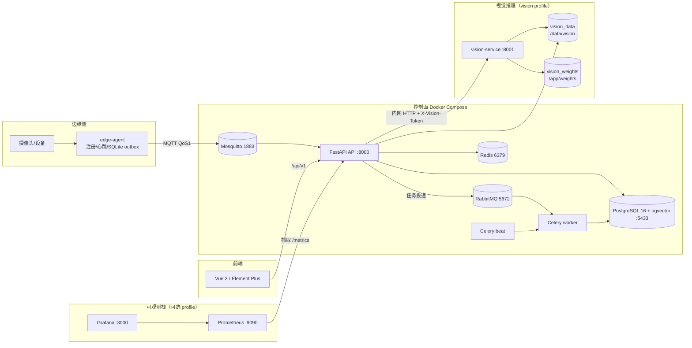
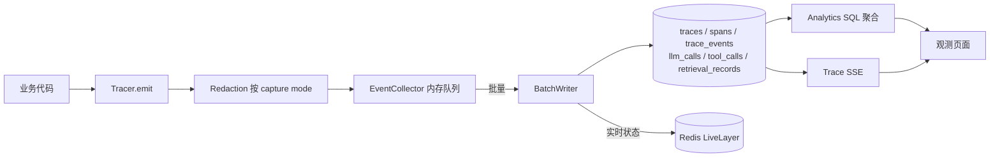

# EdgePilot 架构说明

本文描述 P0–P7 + Vision Center 交付版本的实际结构。目标是把「摄像头/设备 →
视觉事件 → 多 Agent 研判 → 审批与报告 → 可观测追踪」做成一条可配置、可下发、
可离线部署的链路，同时保证观测链路故障不影响业务执行。Vision Center 使用独立
`vision-service` 做预训练 YOLO11n 真实推理，默认 CPU，GPU 不是运行前提；
不训练、不导出。

## 1. 系统上下文



### 运行组件与端口

| 组件 | 端口 | 职责 |
|---|---|---|
| api | 8000 | REST API、SSE、MQTT 上行消费、`/health`、`/metrics` |
| worker | — | 工作流执行、节点恢复；与 api 共用镜像 |
| scheduler | — | Celery beat：审批超时、僵死运行重投 |
| postgres | 5433→5432 | 业务表 + 观测表，pgvector 扩展 |
| redis | 6379 | 设备去重、令牌拒绝列表、Trace 实时状态 |
| rabbitmq | 5672 / 15672 | Celery broker |
| mosquitto | 1883 | 边缘上行与下行指令 |
| vision-service | 8001（仅 `127.0.0.1`） | YOLO11n CPU 推理、作业状态、结果 artifact；`vision` profile |
| prometheus | 9090 | `observability` profile |
| grafana | 3000 | `observability` profile，预置总览看板 |

## 2. 后端分层

```
api/            HTTP 路由、鉴权、请求/响应信封、SSE
services/       业务用例、事务边界、审计、跨表编排
repositories/   数据访问（SQLAlchemy 2.0 异步）
models/         业务 ORM；observability/models 为观测 ORM
observability/  Tracer、Span、Collector、Writer、Redaction、Prompt、Analytics
workflow/       DSL、校验器、执行引擎、表达式求值
agents/         Supervisor + 五个领域 Agent + LLM 客户端
tools/          工具注册表、执行器、内置工具
rag/            解析、分块、embedding、混合检索、重排
messaging/mqtt/ 上行 handler、去重、节点扫描
vision/         规则引擎、几何、快照
tasks/          Celery 工作流任务
```

约束：

- 路由不直接拼 SQL；查询与写入经 service/repository。
- 所有业务表带 `tenant_id`，请求级租户由 `TenantMiddleware` 与 ContextVar 注入；
  跨租户读取返回 404，不泄露资源是否存在。
- 业务表之间不建数据库外键，关联由应用层维护，便于分库/离线迁移。
- 错误统一 `{code, message, data, trace_id}` 信封（成功 `code=0`）。

## 3. 核心数据流

### 3.1 视觉事件上行

1. edge-agent 在 SQLite `pending_messages` 中持久化事件；MQTT 断网时继续入队。
2. 重连后 `MqttClient._on_connect` 循环 flush，直到队列排空或发布失败。
3. 控制面订阅 `edge/+/event`，按 `(tenant_id, node_key, msg_id)` 去重；
   `vision_events.dedup_key` 唯一约束做第二道幂等。
4. 事件写入后可被列表/详情/快照 API 查询，或由工作流触发消费。

关键安全语义：

- 事件载荷缺失字段不补默认值，不伪造置信度或设备读数；
- 模拟事件必须带 `simulated=true`，演示种子数据同样显式标记；
- 离线缓冲语义为至少一次投递，服务端负责去重。

### 3.2 工作流执行

1. `POST /workflows/{id}/runs` 创建 `workflow_runs` 与 `workflow_node_runs`。
2. 引擎按 DSL 推进节点：agent、condition、approval、end；
   发布版本不可变，草稿版本为 0，已发布版本 ≥1。
3. Agent 节点经 Supervisor/领域 Agent 调用 LLM 与工具，写 `agent_runs`。
4. approval 节点暂停运行，operator 在 API/UI 审批后由 Celery 任务恢复。
5. 运行输出、节点状态、报告证据与 trace 关联，可在运行详情与 Trace Detail 查看。

### 3.3 可观测链路



- `trace_id`：W3C 32 位十六进制；`span_id`：16 位十六进制。ID 只做关联，
  页面展示执行时间与内容，不从 ID 编码时间。
- 采样率 `OBS_SAMPLE_RATE`、批量大小 `OBS_BATCH_SIZE`、刷新间隔
  `OBS_FLUSH_MS` 均可配置。
- 采集模式：`OFF` / `METADATA` / `REDACTED` / `FULL`；生产默认
  `REDACTED`。`FULL` 查看完整 prompt/工具参数需管理员权限并写审计。
- 观测写入失败只记录告警并丢弃本批，不向业务调用方抛异常；连续失败会降级到
  `METADATA` 并暴露指标。

### 3.4 视觉推理任务

1. 浏览器 `POST /vision/tasks` 上传视频；backend 做后缀/魔数/大小校验并计算
   SHA-256，写 `vision_tasks`，视频落共享卷 `vision_data`。
2. backend 以 JSON（共享卷路径、哈希、置信度、采样参数）调用
   `vision-service POST /v1/jobs`；服务异步执行，状态写 `/data/vision/jobs/`。
3. API 进程内的轮询器默认每 2s 对账；远端 `completed` 后按「结果 → 事件 →
   `completed`」顺序提交，存在事件且联动开关开启时按配置的工作流名触发运行。
4. 帧级框存 JSON artifact，DB 只存汇总与指针；视频通过签名 URL + Range 播放。
5. 推理任务本身不建 Trace；Agent 研判与工作流运行沿用现有 Tracer。

### 3.5 LLM、工具与 RAG 埋点

- LLM：`LLMClient` 记录 provider/model、token usage、耗时、finish reason；
  provider 未返回 usage/单价时 `usage`/`cost` 为 `NULL`，绝不用估算值填充。
- 工具：`ToolRegistry.execute` 包裹 `_open_tool_span`，记录输入、输出、权限
  判定、重试与耗时；工具失败不会把观测写入失败传播给调用方。
- RAG：检索器记录 query、策略、top_k、候选/重排结果与耗时到
  `retrieval_records`，并挂到当前 span。
- LangGraph：回调把图节点映射为 `span_type=node` 子 span，interrupt 写事件。

## 4. 跨进程追踪

- HTTP→Celery：`traceparent` 写入任务 kwargs，worker 恢复上下文后继续同 trace。
- HTTP→MQTT→控制面：上行 payload 可携带 `traceparent` 扩展字段。
- 线程池：`contextvars` 显式拷贝，避免线程间 trace 丢失。
- Celery prefork：每个子进程初始化观测组件；`worker_ready` 只注册一次。

## 5. 多租户与权限

| 角色 | 能力 |
|---|---|
| admin | 全部读写、发布/回滚、Agent 试跑、用户管理 |
| operator | 触发运行、审批/驳回、事件 ack，只读配置 |
| viewer | 只读 |

- 所有查询强制带租户条件；跨租户访问统一 404。
- JWT access token 15 分钟、refresh 7 天；登出写拒绝列表。
- 审计日志记录敏感操作（发布、回滚、Agent 试跑、工具执行、命令下发等），
  含 `trace_id` 便于关联。
- 模型密钥只存 `api_key_enc`（Fernet），日志与响应不回显明文。

## 6. 部署形态

1. **开发栈**：`docker/compose/docker-compose.yml`，`app` profile；
   前端 Vite dev server 代理 `/api` 到 `127.0.0.1:8000`。
   视觉推理单独使用 `vision` profile，只暴露 `127.0.0.1:8001`；api 不依赖它，
   未启动时 `/vision/*` 返回可解释的不可达状态，其余模块不受影响。
2. **可观测栈**：叠加 `docker-compose.observability.yml`，`observability`
   profile；Prometheus 抓取 `api:8000/metrics`，Grafana 自动加载看板。
3. **离线包**：`scripts/offline_pack.sh` 产出镜像 tar、前端 dist、compose
   目录树、演示夹具、校验和与 `LOAD.md`；目标机 `docker load` 后直接启动，
   不需要构建上下文。

## 7. 明确的非目标与后续

- 本期不做 Replay 与评测闭环（P8）：实验管理、LLM judge、数据标注不在仓库中。
- 视觉只做**预训练 YOLO11n** CPU 推理：不做训练/微调/自定义数据集，
  不做 TensorRT / ONNX 导出，不把 GPU 作为运行前提；不做目标跟踪；
  不做 K8s 多节点调度。推理失败返回明确失败原因，不使用 Mock 或模拟结果兜底。
- MQTT 演示事件仍显式标记 `simulated=true`，与真实推理结果分开，不能互相替代；
  报告必须遵守“无证据不下结论”。
- 不引入 OpenTelemetry SDK/Collector；仅对齐 traceparent 与语义字段，减少
  离线部署体积。
