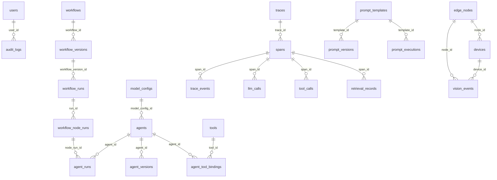

# 数据模型与 ER 说明

## 1. 建模约定

- 当前库 25 张业务/观测表：业务域 16 张、可观测域 9 张；Alembic 版本表
  `alembic_version` 不计入。
- 规划中的第 26 张表 `evaluation_records` 属于 P8（迁移 `0006_evaluation`），
  本期不做评测闭环，因此库内不存在该表。16 + 10 的口径不变，差的一张即 P8 表。
- **不建跨表外键**：关联列（`agent_id`、`workflow_run_id`、`trace_id`、
  `span_id` 等）由应用层维护，删除/归档由 service 负责。这样便于离线迁移、
  分库与演示数据重建，也避免级联删除误伤审计与观测数据。
- 所有业务表带 `tenant_id`；查询必须显式带租户。跨租户读取返回 404。
- 业务表使用 `created_at/updated_at`；观测表多数只追加 `created_at`，
  不再修改历史记录。
- 观测 ID：`traces.trace_id` 为 32 位十六进制，`spans.span_id` 为 16 位
  十六进制；只用于关联，不编码时间。
- 金额列使用 `Numeric`，缺失即 `NULL`；token 列缺失同样为 `NULL`，不写 0。

## 2. 关系总览



> 图中的连线是逻辑关联，数据库中没有对应外键约束。

## 3. 业务域（16 张）

| 表 | 用途 | 关键约束/索引 |
|---|---|---|
| `users` | 账号、角色、状态 | `uq_users_tenant_email` |
| `agents` | Agent 定义与当前版本指针 | `uq_agents_tenant_name`、`(tenant_id, agent_type)` |
| `agent_versions` | 发布快照，只追加 | `uq_agent_versions_agent_version` |
| `agent_tool_bindings` | Agent 与工具的启用关系 | `uq_agent_tool_bindings_agent_tool` |
| `model_configs` | 模型端点与加密密钥、单价 | `uq_model_configs_tenant_name`；`api_key_enc` |
| `tools` | 工具元数据、schema、权限范围 | `uq_tools_tenant_tool_id` |
| `workflows` | 工作流定义与当前版本 | `uq_workflows_tenant_name` |
| `workflow_versions` | DSL 快照；草稿 0，发布 ≥1 | `uq_workflow_versions_workflow_version` |
| `workflow_runs` | 一次运行 | `(tenant_id, status, created_at)`、`trace_id` |
| `workflow_node_runs` | 节点执行/审批状态 | `uq_workflow_node_runs_run_node`、审批等待索引 |
| `agent_runs` | Agent 单次运行 | `(tenant_id, agent_id, created_at)` |
| `devices` | 设备/相机 | `(tenant_id)` |
| `edge_nodes` | 边缘节点、心跳与指标 | `uq_edge_nodes_tenant_node_key` |
| `vision_events` | 视觉事件与去重 | `uq_vision_events_tenant_dedup`、时间倒序索引 |
| `knowledge_chunks` | 知识分块、pgvector 与全文索引 | `uq_knowledge_chunks_doc_chunk`、HNSW/GIN |
| `audit_logs` | 审计日志（含 trace_id） | `(tenant_id, created_at)`、资源索引 |

### 业务表要点

- `agents.current_version=0` 表示从未发布；发布后写入不可变
  `agent_versions`，回滚/发布只移动 `current_version` 指针。
- `workflow_versions.dsl` 存完整节点/边；`dsl_hash` 用于发布幂等与变更检测。
- `workflow_node_runs.approval` 保存审批人、决定与时间；
  `heartbeat_at` 用于检测僵死节点并由 beat 重投。
- `vision_events.payload` 保留原始上行载荷；`received_at` 是服务端落库时间，
  端到端延迟基准用它计算。`dedup_key` 唯一，重复上报不会重复计数。
- `knowledge_chunks.embedding` 可空：未配置 embedding 时仍可用 pg_trgm 与
  全文检索，不伪造向量。

## 4. 可观测域（9 张）

| 表 | 用途 | 关键约束/索引 |
|---|---|---|
| `traces` | 一次追踪的汇总 | `uq_traces_trace_id`、状态/时间索引、metadata GIN |
| `spans` | 层级调用单元 | `uq_spans_span_id`、`(tenant_id,trace_id,start_time)`、按类型/Agent/Tool 的索引 |
| `trace_events` | span 内事件（日志/中断等） | `uq_events_trace_seq`、`(trace_id, created_at)` |
| `llm_calls` | 每次模型调用 | `(span_id, attempt)`、`(tenant_id, model_name, created_at)` |
| `tool_calls` | 每次工具调用 | `(span_id, attempt)`、按工具/状态/时间的索引 |
| `retrieval_records` | 每次 RAG 检索 | `span_id`、`(tenant_id, created_at)` |
| `prompt_templates` | Prompt 模板身份与活动版本 | `uq_prompt_templates_tenant_template` |
| `prompt_versions` | 不可变 Prompt 版本 | `uq_prompt_versions_template_version` |
| `prompt_executions` | 渲染与执行记录 | `(template_id, template_version, created_at)`、`trace_id`/`span_id` |

### 观测表要点

- `traces` 汇总 token/cost、span 数、错误数；`cost_unavailable_count` 明确
  记录“有多少调用没有可用价格”，避免把缺失当 0。
- `spans` 的 `span_type` 包含 `workflow`、`agent`、`node`、`llm`、`tool`、
  `retrieval` 等；`parent_span_id` 构成树，根 span 的 `trace_id` 与
  `root_span_id` 对齐。
- `llm_calls` 同时保存请求消息与结构化响应；`REDACTED` 模式下敏感字段在
  入库前脱敏，`FULL` 模式需要权限且查看行为写审计。
- `tool_calls.permission_result` 记录权限判定，`execution_status` 区分成功、
  失败、超时、拒绝；两者分开，避免把“拒绝执行”误判为工具错误。
- `prompt_versions` 只追加；发布、回滚、Playground 对比都指向具体版本，
  `prompt_executions` 记录本次实际使用的版本与渲染哈希。

## 5. 迁移链

| 版本 | 内容 |
|---|---|
| `0001_core` | 业务域基础表与租户字段 |
| `0002_obs_base` | traces / spans / trace_events |
| `0003_obs_llm_tool_prompt` | llm_calls / tool_calls / prompt_* |
| `0004_obs_retrieval` | retrieval_records 与 RAG 索引 |
| `0005_obs_analytics_indexes` | Analytics 聚合所需索引 |

```bash
cd backend
python -m alembic upgrade head
python -m alembic current
```

## 6. 数据保留

`app/services/retention_service.py` 对 13 张按时间增长的表按租户清理：
业务事件 90 天、观测 180 天、审计 365 天（可用 CLI 参数覆盖）。默认
`--dry-run`；`--execute` 才写库。`vision_events` 分批删除（默认 1000/批）
并清理截图文件，路径越界只告警不删文件。
