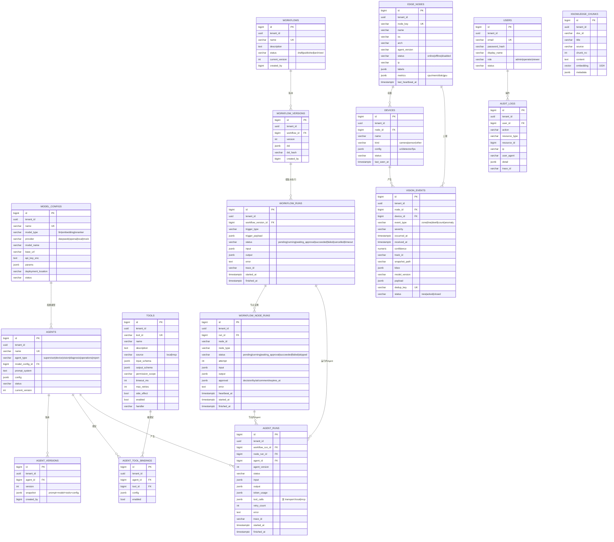

# EdgePilot 架构方案 v2（已确认）

- 日期：2026-11-25
- 状态：**已确认**（2026-11-25 评审通过，5 项决策锁定，见 §4）
- 取代：`2026-11-25-edgepilot-mvp-design.md` 的 §3 架构、§5 数据模型、§7 HITL、§8 Agent 编排、§9 边缘协议
- 本文含四部分：**架构方案 / 数据库 ER 图 / 项目目录结构 / 确认结论与 Phase 1 边界**
- 执行规则：每完成一个 Phase 必须实际运行测试（`make verify`）并写入 `docs/eval.md`，未通过不得进入下一 Phase

---

## 0. 本轮相对 v1 的 8 处变更

| # | 变更 | 影响面 |
|---|---|---|
| 1 | **Docker 优先**：开发、测试、演示、交付全部走镜像，本地 venv 只用于跑单测 | 目录新增 `docker/`，每阶段验收以 `docker compose` 为准 |
| 2 | **多租户 schema，单租户运行**：所有业务表带 `tenant_id`，仓储层强制过滤，默认固定租户 | 表结构、JWT、Celery 任务参数 |
| 3 | **HITL 下沉到节点层**：审批是节点的属性，不是独立环节 | DSL、执行引擎、审批 API |
| 4 | **异步换成 RabbitMQ + Celery**（Redis 只做缓存/结果/pubsub） | 消息栈、worker、重试与死信 |
| 5 | **LangGraph 编排模式逐 Agent 选型**（Plan-and-Execute / ReAct / Evaluator 等） | agents 目录、Prompt、状态结构 |
| 6 | **通知工具封装**：企微 / 短信 / 邮件（语音预留）作为受控工具 | tools/notify，审计与限流 |
| 7 | **显式分层 + TDD**：api → services → domain ← repositories → infrastructure | 目录结构、测试分层、CI |
| 8 | 前端视觉优化延后到功能完成后，用 huashu-design 出三个方向再落到 Vue | 只影响 Phase 7 之后的 UI |

---

## 1. 架构方案

### 1.1 部署形态：Docker 优先

所有组件都有镜像，`docker compose` 是唯一的启动方式（本地 venv 仅用于跑单测，不用于联调）。

| 镜像 | 基础镜像 | 说明 |
|---|---|---|
| `edgepilot/api` | `python:3.11-slim` | FastAPI，非 root，健康检查 `/health` |
| `edgepilot/worker` | 同上（共享层） | Celery worker + Celery Beat |
| `edgepilot/web` | `node:22-alpine` 构建 → `nginx:alpine` | 静态包 + 反向代理 `/api` `/ws` |
| `edgepilot/edge-agent` | `python:3.11-slim` | 模拟节点 ×2，挂载演示视频 |
| `edgepilot/mcp` | `python:3.11-slim` | MCP Server（Streamable HTTP） |

基础设施镜像：`pgvector/pgvector:pg16`、`rabbitmq:3.13-management-alpine`、`redis:7-alpine`、`eclipse-mosquitto:2`。

**MCP 传输方式**：容器里用 **Streamable HTTP**（`/mcp`）而不是 stdio——stdio 无法跨容器共享，HTTP 才能在 worker 重启、横向扩容时复用同一个 MCP 服务。本地不启容器时回退 stdio 子进程，两种 transport 共用同一套工具函数。

### 1.2 异步与消息：RabbitMQ + Celery（+ Redis + MQTT）

四种消息通道各司其职，不重叠：

| 通道 | 承载 | 为什么是它 |
|---|---|---|
| **RabbitMQ** | Celery 任务队列（工作流执行、文档入库、通知发送） | JD 明确要求 MQ；支持 ack、死信、优先级、路由，重试语义比 Redis Stream 完整 |
| **Celery** | 任务编排与重试 | `acks_late` + `reject_on_worker_lost` + `RetryPolicy`，进程被杀能重投 |
| **MQTT** | 边缘节点上行/下行（心跳、指令、事件） | 端侧弱网、遗嘱消息、低带宽，天然适配 |
| **Redis** | 缓存、WS 广播、幂等键、锁、Celery 结果后端 | 高频小数据，不做可靠队列 |

Celery 配置必须项：

```
broker_url            = amqp://…
result_backend        = redis://…
task_acks_late        = True
task_reject_on_worker_lost = True
worker_prefetch_multiplier = 1
task_default_queue    = q.workflow
task_queues           = q.workflow / q.ingest / q.notify
task_routes           = {run_workflow: q.workflow, ingest_document: q.ingest, send_notification: q.notify}
task_soft_time_limit  = 55   # 秒
task_time_limit       = 60
broker_transport_options = {visibility_timeout: 3600}
```

死信：`q.workflow.dlx` / `q.notify.dlx`，消费端把死信写入 `audit_logs` 并在 UI 暴露「失败任务」列表。

Celery Beat 负责三件定时任务：审批超时扫描、节点离线扫描、数据保留清理。

> **worker 内如何用异步 ORM**：仓储层只写一份 async 实现，Celery 任务里用 `asyncio.run(engine.handle(run_id))` 驱动（每进程一个 `NullPool` engine，避免跨事件循环）。这样不需要维护 sync/async 两套仓储。

### 1.3 多租户：schema 支持、单租户运行

- 所有业务表加 `tenant_id uuid not null`，**唯一约束一律带 tenant_id**（如 `(tenant_id, name)`）。
- 固定租户 `TENANT_DEFAULT_ID`，从 `.env` 读，所有新数据默认写入该租户。
- 请求链路：`JWT.payload.tid` → `TenantContext`（contextvar）→ 仓储基类 `select(...).where(model.tenant_id == ctx.tid)`，业务代码不写租户条件。
- Celery 任务参数携带 `tenant_id`，任务开始时设置 context 并断言非空。
- MQTT 上行：节点在注册时绑定 `tenant_id`，事件按节点归属落库。
- **不建 `tenants` 表**（守住 16 张表），二期加表 + 租户切换 UI。

越权测试：A 租户 token 访问 B 租户资源必须 404（不是 403，避免泄露存在性）。

### 1.4 HITL：节点层审批

审批不再是独立环节，而是**节点的执行前门控**。DSL 每个节点可选带 `approval`：

```json
{"id":"report","type":"agent","agent":"report",
 "approval":{"required":true,"approvers":["operator","admin"],
             "title":"高风险事件需确认","timeout_ms":86400000}}
```

执行器统一处理（只有一条代码路径）：

```
NodeExecutor.run(node):
  if node.approval.required and no decision:
      node_run.status = waiting_approval
      run.status      = waiting_approval
      publish ws event; return PAUSED
  if decision == rejected: node_run.status = skipped; continue downstream? -> false branch
  execute node
```

- `approval` 节点类型仍然保留，等价于「没有业务逻辑、只有审批策略」的节点（纯人工门）。
- 恢复：审批 API 写决策 → run 回 `running` → 重新投递 Celery 任务（payload 带 `resume_node_id`）→ 从该节点继续，已成功节点不重放。
- 超时：`timeout_ms` 到点由 Beat 置 `failed(approval_timeout)`。
- 重启：任务 `acks_late`，worker 被杀后由 broker 重投；执行器用 `(run_id, node_id, attempt)` 幂等，不会重复执行成功节点。
- **不用 LangGraph `interrupt`**：审批需要可查询、可审计、可被外部 API 驱动，且要在 worker 重启后存活。图内 interrupt 会把 LangGraph 变成第二个状态机，和 Celery 的重试语义打架。`create_react_agent(interrupt_before=...)` 仅作为未来工具级确认的预留，不启用。

### 1.5 LangGraph 编排模式选型（研究结论）

本机 `langgraph 1.0.1`：`Send` / `Command` / `Interrupt` / `RetryPolicy` 在 `langgraph.types`；`langgraph.prebuilt.create_react_agent` 可用；`PostgresSaver` 可用。以下写法按此版本。

| Agent | 采用模式 | 为什么 |
|---|---|---|
| **Supervisor** | **Plan-and-Execute + Orchestrator-Workers**（`Send` 并行扇出） | 任务需要先解析成结构化计划，再并行取证，最后汇总；串行 ReAct 会浪费延迟 |
| **Device** | **ReAct**（`create_react_agent`，工具白名单 2 个，max 4 步） | 单域问答，工具少，ReAct 足够且稳定 |
| **Vision** | **ReAct**（2 个工具，max 4 步） | 同上；事件查询是典型的工具调用循环 |
| **Operations** | **ReAct**（2 个工具，max 4 步） | 同上 |
| **Diagnosis** | **ReAct + Evaluator-Optimizer**（1 个检索工具 + 证据完备性自检，最多 1 次补检索） | 诊断必须带证据，缺证据要主动补查一次，而不是直接下结论 |
| **Report** | **Prompt Chaining / 单次结构化输出**（仅 1 个 `generate_report` 工具） | 报告是确定性汇总，多轮只会引入幻觉 |

Supervisor 图（`Send` 并行 + 有界重规划）：

```
START → plan(LLM, JSON schema) → route(Send 扇出)
          ├→ device ─┐
          ├→ vision ─┼→ join → assess ──(证据不足且 replan<2)→ plan
          └→ ops ────┘                    └(足够)→ synthesize → END
```

**硬边界（写死在代码里，不靠 Prompt）**：

- Supervisor 最多 6 次 Agent 调用、2 次重规划、总 token 上限 60k、总时长 60s
- Supervisor 无数据工具权限，只能调用 Agent（防止编排器绕过权限）
- 每个 Agent 的输出走 Pydantic Schema，失败重试 1 次后返回 `agent_output_invalid`
- 所有结论必须带 `evidence[]`（event_id / metric / chunk_id），空证据的结论字段置 null
- 每个 Agent 运行独立 `agent_run` 行，挂同一个 `trace_id`；checkpoint 用 `PostgresSaver`（thread_id = agent_run_id），用于复盘与断点调试，**不用于 HITL**

未采用：Debate（成本高、收益不确定）、全自主 Reflection 循环（不可控）、纯 Routing（无法处理"多区域统计"这类需要分解的请求）。

### 1.6 通知工具封装

统一 `NotificationChannel` 协议，四种实现：

| 渠道 | 实现 | 备注 |
|---|---|---|
| 企业微信 | 群机器人 webhook（默认）/ 应用消息（预留 corp secret） | 演示用 webhook，零审批成本 |
| 短信 | 阿里云 / 腾讯云 adapter | 未配置时自动 `dry_run` |
| 邮件 | SMTP | 附件支持报告 PDF/Markdown |
| 语音电话 | 预留接口，`enabled=false` | 复用你简历里的四通道经验，本期不接 |

统一约束（在 Tool Registry 里强制，不靠调用方自觉）：

- `side_effect = true`，必须在 `audit_logs` 留痕
- `dry_run` 模式：不真发，写一条 `simulated` 审计并返回合成结果（离线演示用）
- 幂等键 `event_id:channel`，重复调用不重发
- 限流：每渠道 10 条/分钟（Redis 令牌桶）
- 模板与渲染分离：`tools/notify/templates/*.j2`，不允许在代码里拼字符串

### 1.7 分层与 TDD

**依赖方向严格向内**：

```
api (FastAPI routers)  →  services (use cases / 事务 / 权限)
                              ↓
                    domain (枚举/策略/值对象，纯 Python)
                              ↑
repositories (SQLAlchemy)  ←  infrastructure (PG/Redis/RabbitMQ/MQTT/MCP/LLM/存储)
```

- `domain` 不 import FastAPI / SQLAlchemy / Celery
- `api` 只做参数解析、鉴权依赖、调用 service、序列化
- `services` 持有事务边界与权限判断
- `repositories` 只做持久化，不写业务分支
- `workflow` / `agents` / `tools` 是应用层，通过 repository 与 registry 协作

**TDD 循环（每个 Phase 强制执行）**

1. 按验收标准先写失败测试（unit / integration / e2e）
2. 最小实现让测试变绿
3. 重构，保持绿
4. `make verify`：起 compose → 迁移 → pytest（含覆盖率）→ e2e → 关 compose
5. 覆盖率报告写进 `docs/eval.md`，低于门槛不允许进入下一 Phase

测试分层与目录一一对应（见 §3），**不存在"写完再补测试"的路径**。

### 1.8 组件图

```
                         ┌──────────── web (nginx + Vue3) ────────────┐
                         │ 10 页面：Dashboard/Agent/工作流编辑/运行追踪 │
                         └──────┬─────────────────────────┬───────────┘
                          /api  │                         │ /ws
                         ┌──────▼─────────────────────────▼───────────┐
                         │              api (FastAPI)                  │
                         │  auth · RBAC · CRUD · WS 广播 · /metrics     │
                         └───┬──────────┬──────────┬──────────┬───────┘
                             │          │          │          │
                    ┌────────▼───┐ ┌────▼─────┐ ┌──▼──────┐ ┌─▼────────┐
                    │ PostgreSQL │ │  Redis   │ │RabbitMQ │ │  MQTT    │
                    │ pgvector   │ │cache/pub │ │ +DLX    │ │ broker   │
                    └────────┬───┘ └──────────┘ └──┬──────┘ └─┬────────┘
                             │                     │            │
                         ┌───▼─────────────────────▼──┐   ┌─────▼──────────┐
                         │ worker (Celery + Beat)      │   │ edge-agent ×2  │
                         │ workflow engine · 6 Agents  │   │ 心跳/探测/抽帧  │
                         │ RAG · notify · retention    │   │ 本地 SQLite 队列 │
                         └───┬──────────────┬──────────┘   └────────────────┘
                             │              │
                        ┌────▼─────┐  ┌─────▼──────┐
                        │ MCP srv  │  │  LLM 网关   │
                        │(Streamable│ │DeepSeek/   │
                        │  HTTP)   │  │ Mock       │
                        └──────────┘  └────────────┘
```

核心请求流（与 v1 一致，仅队列换成 RabbitMQ）：

```
POST /workflows/{id}/runs → 写 workflow_runs(pending) + node_runs(pending) → run_workflow.delay(run_id)
  → Celery worker → 执行 DAG → 节点命中 approval → run=waiting_approval，任务结束（不占 worker）
  → POST /runs/{id}/approve → 写决策 → run_workflow.delay(resume_node_id) → 从下游继续
  → 完成 → agent_runs / tool_calls / audit_logs 全量落库 → WS 推送 → 报告返回
```

### 1.9 安全与可观测

JWT（access 15min + refresh 7d，Redis 可吊销）、argon2 密码、RBAC 依赖注入、租户上下文强制过滤、写接口 `Idempotency-Key`、`/metrics`（Prometheus 文本格式）、structlog JSON 日志、`trace_id` 贯穿 API→Celery→Agent→Tool→MQTT。密钥只从 env 读，`model_configs.api_key_enc` 用 Fernet 加密，日志统一脱敏。

---

## 2. 数据库 ER 图（16 张表）

> 所有业务表都含 `tenant_id uuid not null`（图中 DB 未画出以保持可读），唯一约束一律带 tenant_id。
> 公共审计字段：`created_at`、`updated_at`（`audit_logs` / `knowledge_chunks` 只有 `created_at`）。



**关键索引与约束**

| 表 | 索引 / 约束 |
|---|---|
| users | `unique(tenant_id, email)` |
| agents | `unique(tenant_id, name)`；`index(tenant_id, agent_type)` |
| agent_versions | `unique(agent_id, version)`；发布后不可 UPDATE |
| tools | `unique(tenant_id, tool_id)` |
| agent_tool_bindings | `unique(agent_id, tool_id)` |
| workflows | `unique(tenant_id, name)` |
| workflow_versions | `unique(workflow_id, version)`；不可变 |
| workflow_runs | `index(tenant_id, status, created_at desc)`；`index(trace_id)` |
| workflow_node_runs | `unique(run_id, node_id)`；`index(status) where status='waiting_approval'` |
| vision_events | `unique(dedup_key)`；`index(tenant_id, occurred_at desc)`；`index(device_id, occurred_at desc)` |
| agent_runs | `index(agent_id, created_at desc)`；`gin(tool_calls)` |
| knowledge_chunks | `hnsw(embedding vector_cosine_ops)`；`unique(doc_id, chunk_no)`；`gin(to_tsvector('simple', content))` |
| audit_logs | `index(tenant_id, created_at desc)`；`index(resource_type, resource_id)` |

**事务边界**：发布工作流/Agent（插版本 + 更新 current_version）；创建 run（run + 全部 node_run 预插）；审批（决策 + 状态 + 入队，先落库后投递）。

---

## 3. 项目目录结构

```
EdgePilot/
├─ README.md
├─ .env.example
├─ .pre-commit-config.yaml
├─ Makefile                          # up / down / migrate / test / e2e / verify / seed / pack
├─ .github/workflows/ci.yml          # ruff + pytest --cov + web build
│
├─ docker/
│  ├─ api.Dockerfile                 # python:3.11-slim，非 root，healthcheck
│  ├─ worker.Dockerfile              # 复用 api 层
│  ├─ web.Dockerfile                 # node:22 build → nginx
│  ├─ edge-agent.Dockerfile
│  ├─ mcp.Dockerfile
│  ├─ nginx/default.conf             # /api、/ws 反代，静态资源缓存
│  └─ compose/
│     ├─ docker-compose.yml          # postgres/rabbitmq/redis/mosquitto/api/worker/web/mcp
│     ├─ docker-compose.observability.yml   # prometheus + grafana（profile）
│     ├─ docker-compose.demo.yml     # edge-agent ×2 + seeder
│     └─ .env.example
│
├─ backend/
│  ├─ pyproject.toml                 # ruff / pytest / coverage 配置
│  ├─ requirements.txt
│  ├─ alembic.ini
│  ├─ migrations/
│  │  ├─ env.py
│  │  └─ versions/                   # 每 Phase 一个迁移文件
│  ├─ app/
│  │  ├─ main.py                     # FastAPI 入口（uvicorn app.main:app）
│  │  ├─ worker.py                   # Celery 入口 + Beat 调度表
│  │  ├─ core/
│  │  │  ├─ config.py                # pydantic-settings，全部 env
│  │  │  ├─ security.py              # JWT / argon2 / Fernet
│  │  │  ├─ tenancy.py               # TenantContext(contextvar) + 依赖
│  │  │  ├─ logging.py               # structlog JSON + trace_id 注入
│  │  │  ├─ exceptions.py            # 统一异常 → 统一响应
│  │  │  ├─ pagination.py
│  │  │  ├─ rate_limit.py            # Redis 令牌桶
│  │  │  └─ metrics.py               # Prometheus 指标定义
│  │  ├─ api/
│  │  │  ├─ deps.py                  # get_db / get_current_user / require(role, perm)
│  │  │  └─ v1/
│  │  │     ├─ router.py             # 聚合所有子路由
│  │  │     ├─ auth.py  agents.py  models.py  tools.py
│  │  │     ├─ workflows.py  runs.py
│  │  │     ├─ nodes.py  devices.py  events.py
│  │  │     ├─ knowledge.py  dashboard.py  users.py  audit.py
│  │  │     └─ ws.py                 # /ws/events、/ws/runs/{id}
│  │  ├─ schemas/                    # Pydantic DTO（与 ORM 分离）
│  │  │  ├─ common.py  auth.py  agent.py  model.py  tool.py
│  │  │  ├─ workflow.py  run.py  node.py  device.py  event.py
│  │  │  └─ knowledge.py  dashboard.py
│  │  ├─ domain/                     # 纯 Python，无框架依赖
│  │  │  ├─ enums.py                 # 状态机枚举、事件类型、角色
│  │  │  ├─ errors.py
│  │  │  ├─ entities/                # RunState、NodeState、Evidence…
│  │  │  └─ policies/
│  │  │     ├─ permissions.py        # 3 角色 × 资源权限矩阵
│  │  │     ├─ approval.py           # 审批策略判定
│  │  │     └─ retention.py
│  │  ├─ models/                     # SQLAlchemy ORM（16 表）
│  │  │  ├─ base.py                  # Base / TenantMixin / TimestampMixin
│  │  │  ├─ user.py  agent.py  model_config.py  tool.py
│  │  │  └─ workflow.py  run.py  node.py  device.py  event.py
│  │  │     knowledge.py  audit.py
│  │  ├─ repositories/
│  │  │  ├─ base.py                  # 强制 tenant 过滤 + 通用 CRUD
│  │  │  └─ user_repo.py  agent_repo.py  workflow_repo.py  run_repo.py
│  │  │     node_repo.py  device_repo.py  event_repo.py
│  │  │     knowledge_repo.py  audit_repo.py
│  │  ├─ services/                   # use case + 事务 + 权限
│  │  │  ├─ auth_service.py  agent_service.py  tool_service.py
│  │  │  ├─ workflow_service.py  run_service.py
│  │  │  ├─ node_service.py  device_service.py  event_service.py
│  │  │  └─ knowledge_service.py  dashboard_service.py  audit_service.py
│  │  ├─ workflow/
│  │  │  ├─ dsl.py                   # 节点/边模型、approval 策略
│  │  │  ├─ validator.py             # 环检测/可达性/表达式白名单
│  │  │  ├─ engine.py                # 状态机 + 幂等 + resume
│  │  │  ├─ executor.py              # 节点分派 + 审批门
│  │  │  ├─ expression.py            # 受限表达式求值
│  │  │  └─ nodes/
│  │  │     ├─ start.py  agent_node.py  tool_node.py
│  │  │     └─ condition.py  approval_node.py  end.py
│  │  ├─ agents/
│  │  │  ├─ base.py                  # 通用 runner、Schema 校验、预算
│  │  │  ├─ supervisor.py            # Plan-and-Execute + Send 扇出
│  │  │  ├─ device.py  vision.py  operations.py     # ReAct
│  │  │  ├─ diagnosis.py             # ReAct + Evaluator
│  │  │  ├─ report.py                # 单次结构化输出
│  │  │  ├─ schemas.py               # 6 个 Agent 的输入输出契约
│  │  │  ├─ prompts/                 # supervisor.md device.md …
│  │  │  └─ llm.py                   # LLMClient: real / mock / auto 降级
│  │  ├─ tools/
│  │  │  ├─ registry.py              # 注册、MCP 同步、upsert
│  │  │  ├─ executor.py              # 权限→schema→超时→重试→审计
│  │  │  ├─ builtin/
│  │  │  │  ├─ device_status.py  device_telemetry.py  edge_metrics.py
│  │  │  │  ├─ vision_events.py  alarm_events.py  model_status.py
│  │  │  │  └─ task_history.py  knowledge_search.py  report_gen.py
│  │  │  ├─ notify/
│  │  │  │  ├─ base.py               # NotificationChannel 协议 + DeliveryResult
│  │  │  │  ├─ wecom.py  sms.py  email.py  voice.py
│  │  │  │  └─ templates/            # 企微/短信/邮件 jinja2 模板
│  │  │  └─ mcp/client.py            # Streamable HTTP + stdio 双 transport
│  │  ├─ rag/
│  │  │  ├─ loader.py  chunker.py  embedder.py
│  │  │  ├─ indexer.py  retriever.py  reranker.py  service.py
│  │  ├─ vision/
│  │  │  ├─ detectors/  base.py  mock.py  yolo.py   # yolo 仅骨架
│  │  │  ├─ rules/  zone.py  line.py  dwell.py  count.py
│  │  │  └─ snapshot.py              # ffmpeg 抽帧、降级占位
│  │  ├─ messaging/
│  │  │  ├─ celery_app.py            # broker/queue/DLX/Beat 配置
│  │  │  ├─ mqtt/  client.py  topics.py  handlers.py
│  │  │  └─ pubsub.py                # Redis pub/sub → WebSocket
│  │  └─ tasks/
│  │     ├─ workflow_tasks.py  ingest_tasks.py
│  │     └─ notify_tasks.py  retention_tasks.py
│  └─ tests/
│     ├─ conftest.py                 # 测试 DB/租户/用户/客户端 fixture
│     ├─ unit/
│     │  ├─ core/  domain/  services/
│     │  ├─ workflow/  tools/  rag/  vision/
│     ├─ integration/
│     │  ├─ repositories/  mqtt/  celery/  mcp/
│     ├─ e2e/
│     │  ├─ test_auth_flow.py  test_agent_flow.py
│     │  ├─ test_workflow_approval_flow.py  test_edge_flow.py
│     ├─ perf/
│     │  ├─ bench_event_latency.py  bench_concurrent_runs.py
│     └─ fixtures/
│        ├─ llm/                     # 录制回放 JSON
│        ├─ events/                  # 事件种子
│        └─ media/                   # 演示视频帧
│
├─ edge-agent/
│  ├─ pyproject.toml
│  ├─ edge_agent/
│  │  ├─ main.py                     # CLI：--simulate --nodes 2
│  │  ├─ config.py
│  │  ├─ mqtt_client.py              # 重连/遗嘱/QoS
│  │  ├─ registry.py                 # 注册（幂等）
│  │  ├─ heartbeat.py                # 5s，cpu/mem/disk/gpu
│  │  ├─ devices/  probe.py  capture.py
│  │  ├─ pipeline/  runner.py  detector.py
│  │  ├─ outbox.py                   # SQLite 待发队列（断网补传）
│  │  └─ simulator.py
│  └─ tests/
│     ├─ test_outbox.py  test_registry.py  test_probe.py
│
├─ mcp-server/
│  ├─ pyproject.toml
│  ├─ mcp_server/
│  │  ├─ main.py                     # Streamable HTTP / stdio
│  │  ├─ auth.py                     # 内部 token 校验
│  │  └─ tools/  device_status.py  knowledge_search.py
│  └─ tests/  test_tools.py
│
├─ web/
│  ├─ package.json  vite.config.ts  tsconfig.json  index.html
│  └─ src/
│     ├─ main.ts  App.vue
│     ├─ api/          http.ts auth.ts agents.ts workflows.ts runs.ts
│     │                nodes.ts events.ts knowledge.ts dashboard.ts
│     ├─ stores/       auth.ts agent.ts workflow.ts run.ts event.ts ui.ts
│     ├─ router/       index.ts guards.ts
│     ├─ layouts/      DefaultLayout.vue
│     ├─ views/        Login.vue Dashboard.vue
│     │                Agents.vue AgentDetail.vue
│     │                Workflows.vue WorkflowEditor.vue
│     │                Runs.vue RunDetail.vue
│     │                Nodes.vue Devices.vue Events.vue
│     │                Knowledge.vue Settings.vue
│     ├─ components/
│     │  ├─ workflow/  Canvas.vue NodePanel.vue PropertyPanel.vue
│     │  │             nodes/ StartNode.vue AgentNode.vue ToolNode.vue
│     │  │                    ConditionNode.vue ApprovalNode.vue EndNode.vue
│     │  ├─ events/    EventCard.vue EventDrawer.vue SnapshotViewer.vue
│     │  ├─ runs/      NodeTimeline.vue ApprovalCard.vue ToolCallList.vue
│     │  ├─ common/    StatCard.vue EmptyState.vue ErrorState.vue PageHeader.vue
│     │  └─ charts/    TrendChart.vue GaugeChart.vue
│     ├─ composables/  useWebSocket.ts usePolling.ts usePermission.ts
│     ├─ types/        api.d.ts workflow.d.ts event.d.ts
│     └─ styles/       tokens.css base.css
│
├─ scripts/
│  ├─ seed_demo.py                   # 2 节点/4 相机/200 事件/演示知识库
│  ├─ retention.py                   # --dry-run
│  ├─ offline_pack.sh                # 镜像 save + 模型 + 前端包
│  ├─ wait_for_stack.sh
│  └─ gen_docs.py                    # 由模型生成 ER / API 文档
│
└─ docs/
   ├─ specs/
   │  ├─ 2026-11-25-edgepilot-mvp-design.md
   │  └─ 2026-11-25-edgepilot-architecture.md   ← 本文
   ├─ architecture.md                # Mermaid 架构图 + 请求流
   ├─ er.md                          # ER 图 + 索引/事务说明
   ├─ api.md                         # 由 OpenAPI 导出
   ├─ runbook.md                     # 启停/排障/日志位置
   ├─ offline-install.md             # 断网部署步骤
   ├─ eval.md                        # 每 Phase 测试与指标实测
   └─ demo-script.md                 # 3 分钟演示脚本
```

**构建与测试命令（Makefile 唯一入口）**

| 命令 | 作用 |
|---|---|
| `make up` | `compose --profile core up -d --build` |
| `make migrate` | 容器内 `alembic upgrade head` |
| `make test` | 后端 unit + integration，输出覆盖率 |
| `make e2e` | 起全套 + `pytest tests/e2e` + 关栈 |
| `make verify` | 每 Phase 的强制 gate：up → migrate → test → e2e → 报告 |
| `make seed` | 演示数据 |
| `make demo` | core + demo profile，2 个模拟节点 |
| `make pack` | 离线安装包 |

---

## 4. 确认结论（2026-11-25 评审通过，已锁定）

以下 5 项为已确认决策，作为后续所有实现与 Phase 划分的约束基线。任何改动需先修改本文档并重新确认。

| # | 决策项 | 结论 | 落地时必须满足的约束 |
|---|---|---|---|
| 1 | 消息与异步栈 | **RabbitMQ + Celery**，保留 Redis 与 MQTT | Celery 必须 `task_acks_late=True`、`task_reject_on_worker_lost=True`、`worker_prefetch_multiplier=1`；三个队列 `q.workflow` / `q.ingest` / `q.notify`，各配 DLX；Redis 只做缓存/结果/pub-sub，**不得承载可靠任务** |
| 2 | HITL 位置 | **节点层**：审批是节点属性 | DSL 的任意节点类型都必须支持 `approval` 字段，不得只允许 `approval` 节点；执行器单一入口判断审批；审批状态可查询、可审计、可被外部 API 驱动；**不使用 LangGraph `interrupt` 实现审批** |
| 3 | Agent 编排模式 | Supervisor 用 **Plan-and-Execute + Orchestrator-Workers**（`Send` 并行扇出）；Device / Vision / Operations 用 **ReAct**；Diagnosis 用 **ReAct + Evaluator-Optimizer**；Report 用**单次结构化输出** | `Send` / `Command` 必须从 `langgraph.types` 导入（1.0.1 起 `langgraph.graph` 不再导出）；预算上限（6 次调用 / 2 次重规划 / 60k token / 60s）写死在代码里，不写入 Prompt |
| 4 | 数据模型与租户 | **16 张表 + `tenant_id`**，单租户运行，**不建 `tenants` 表** | 所有唯一约束带 `tenant_id`；租户过滤在仓储基类统一实现，业务代码不写租户条件；Celery 任务参数必须携带 `tenant_id` 且启动时断言；跨租户访问返回 **404**（非 403） |
| 5 | 目录与分层 | **采用 §3 结构，14 个一级包不合并** | `domain` 不得 import FastAPI / SQLAlchemy / Celery；`api` 不写业务逻辑；测试目录与分层一一镜像；`make verify` 是唯一阶段门禁 |

**变更控制**：Phase 2 及以后如确需新增表（如 `tenants`、`documents`），必须单独提交表结构变更说明，不得在本期静默加入。

---

## 5. Phase 1 边界（确认后立即执行）

### 5.1 范围（只做这些）

1. 仓库骨架：`Makefile`、`.env.example`、`.pre-commit-config.yaml`、`.github/workflows/ci.yml`
2. `docker/`：api / worker / web / mcp / edge-agent 五个 Dockerfile + nginx 配置 + 三份 compose
3. 基础设施起栈：PostgreSQL(pgvector) / RabbitMQ / Redis / Mosquitto
4. `backend/app/core`：`config` / `logging` / `exceptions` / `tenancy` / `security` / `metrics`
5. `backend/app/models/base.py` + `user.py`：`TenantMixin`、`TimestampMixin`、`users` 表
6. 首个 Alembic 迁移（仅 `users`）
7. 三个探针与三个认证接口：`/health`、`/readyz`、`/metrics`；`POST /auth/login`、`POST /auth/refresh`、`GET /auth/me`
8. 测试：`unit`（config / security / tenancy）、`integration`（users 仓储 / 租户过滤）、`e2e`（认证闭环）
9. `docs/eval.md` 写入第一阶段实测记录

**明确不做**：Agent、工作流引擎、MQTT 业务逻辑、RAG、视觉、业务前端页面（`web` 只放一个可构建的占位页）。

### 5.2 验收标准（`make verify` 必须全绿）

| # | 验收项 | 判定方式 |
|---|---|---|
| 1 | 全栈可启动 | `docker compose up -d` 后 api/worker/web/mcp/postgres/rabbitmq/redis/mosquitto 全部 `healthy` 或 `running` |
| 2 | 迁移可执行 | `alembic upgrade head` 成功，`users` 表存在且含 `tenant_id` 与 `unique(tenant_id,email)` |
| 3 | 登录闭环 | 正确凭据返回 access/refresh；错误密码 401，且响应为标准错误结构（`code/message/trace_id`） |
| 4 | 鉴权生效 | 无 token 访问 `/auth/me` 返回 401；带 token 返回当前用户 |
| 5 | 租户隔离 | 集成测试构造两个 tenant，A 的 token 查 B 的资源返回 404 |
| 6 | 可观测 | `/metrics` 返回 Prometheus 文本格式，含 `edgepilot_` 前缀指标 |
| 7 | 覆盖率 | `core` ≥ 85%，后端整体 ≥ 70% |
| 8 | 门禁 | `make verify` 退出码 0，输出写入 `docs/eval.md` |

### 5.3 测试清单（先写测试，再实现）

- `unit/core/test_config.py`：缺失必填 env 时启动即失败；默认值符合预期
- `unit/core/test_security.py`：JWT 签发/校验/过期；密码 hash 与校验；错误 token 拒绝
- `unit/core/test_tenancy.py`：contextvar 未设置时拒绝访问；设置后可读
- `integration/repositories/test_user_repo.py`：创建/查询、`unique(tenant_id,email)` 冲突、跨租户不可见
- `e2e/test_auth_flow.py`：login → me → refresh → 旧 token 行为
- `integration/test_health.py`：`/health` 无依赖、`/readyz` 检查 PG/Redis/RabbitMQ 连通

### 5.4 交付物

启动命令与端口说明（`docs/runbook.md` 初版）、`docs/eval.md` 第一阶段记录、`make verify` 可复现的完整输出截图或日志摘要。

