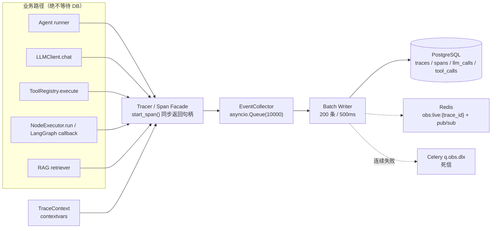

# EdgePilot 可观测中心 架构方案（评审稿 v0.1）

- 日期：2026-11-25
- 状态：待评审。评审通过后才进入 Phase 1，本稿不含实现代码。
- 依据：用户 2026-11-25《EdgePilot Observability Center》需求；`2026-11-25-edgepilot-architecture.md`（v2，下称 v2 稿）。
- 关系：取代 v2 稿的 §1.9（可观测部分）、`agents.prompt_system`、`agent_runs.token_usage/tool_calls`，其余条款继续有效。

---

## 0. 前提修正（必须先读）

**仓库当前 0 代码。** `git ls-files` 只有 README，16 张表只存在于 v2 稿的 Mermaid 与表格里，Alembic 尚未初始化。

因此需求 PART 02 的"检查现有项目、复用已有 trace_id、禁止重复创建 Agent/Tool/Prompt 模块"没有对象可查；本稿把它改写成可执行的等价动作：**在首版迁移基线里就把观测模型建好，埋点随功能一起写**，而不是事后回改。

建设路径已确认：**观测层合并进底座**。需求原文的 Phase 1–7 顺序（先建 tracer，再追踪）在本仓库不成立，本稿 §13 给出重排后的阶段。

### 0.1 本稿相对需求原文的 9 处修正

| # | 需求原文 | 本稿 | 原因 |
|---|---|---|---|
| 1 | `trace_20261125_000001` | 32 位小写 hex（OTel 兼容），人类可读信息放 `traces.name` | 未来接 `traceparent`/OTel exporter 不需要换 ID 方案 |
| 2 | PART 4.3 有 Success/Error/Failed/Retrying 四个近义状态 | 统一为 v2 的 `succeeded/failed/timeout/cancelled/skipped/waiting_approval`；"这次失败但会重试"由 attempt 子 span 表达 | 与 `workflow_runs/node_runs` 状态词表统一，避免两套状态机 |
| 3 | 10.x 的 10 张表均无 `tenant_id` | 全部加 `tenant_id uuid not null` | v2 §1.3 仓储层强制过滤，缺列即越权漏洞 |
| 4 | ER 图 `SPANS ||--o| LLM_CALLS`（1:1） | **1:N**，每次 attempt 一行 | PART 5.1 要求重试可追溯，1:1 与重试互斥 |
| 5 | PART 07–09 列出的字段多于 10.3–10.8 建表字段 | 以 PART 07–09 为准补列（见 §5.2） | 否则按建表语句实现，需求承诺的字段必然缺失 |
| 6 | Prompt 与 `agents.prompt_system` 并存 | Prompt 升为一等实体，删除 `agents.prompt_system` | 否则"Agent 当前用哪版 Prompt"有两个答案 |
| 7 | 部署图无消息队列，但要异步 worker + 死信 | 进程内有界队列 + 批量落库；死信复用 Celery `q.obs.dlx` | 不为观测新增第二套消息组件 |
| 8 | 多处提 OpenTelemetry Collector | 语义对齐（traceparent、attributes、events），P1 不引入 SDK 与 collector | 目标环境无 `opentelemetry-sdk`；单机离线交付不增加容器 |
| 9 | Evaluation、Replay 列为核心 | 拆为 P8 子项目，各自 spec → plan | v2 已把评测闭环列入二期；这是成本最高的两块 |

### 0.2 决策状态

| 决策 | 状态 | 日期 |
|---|---|---|
| 建设路径：观测层合并进底座 | **已确认** | 2026-11-25 |
| D1 数据模型 A（span 为执行真相） | **已确认** | 2026-11-25 |
| D2–D9、S1–S4 | 默认采纳，未逐条确认 | — |

未确认项按推荐项执行，逐条记录在 §14；若后续否决，按该节的"选非推荐项的时间代价"返工。D1 确认后，§5 字段变更、§8 统计口径、§12 阶段划分均已按 A 定稿，B/C 方案不再保留分支描述。

---

## 1. 定位与边界

**定位**：EdgePilot 的执行事实层。回答"一次请求产生了什么、每一步花了多久、谁在什么 Prompt 下调了什么工具、结果有没有证据"。它不是日志系统，也不做业务状态机。

**做**

- Trace / Span / Event 的采集、存储、查询、可视化。
- LLM / Tool / Retrieval 的逐次调用记录（含 attempt）。
- Prompt 模板、不可变版本、渲染执行记录、Playground。
- 运行分析：耗时、token、成本、成功率、慢请求、失败分布。
- 历史 Trace 的只读回放（P7）。

**不做（本期）**

- Agent 评测（数据集、evaluator、实验对比）→ P8 子项目。
- Re-execution 沙箱重跑与两次执行对比 → P8。
- OTel Collector / Jaeger 后端对接 → 二期适配器。
- 独立观测数据库、分表分区、冷热分层 → 数据量见 §12.4，目前不需要。
- 边缘事件上报的逐条 Trace → MQTT 入库不建 Trace（见 §2.2），只在下行指令含 `task_id` 时关联。

---

## 2. 数据流与采集架构

### 2.1 进程内采集（不阻塞业务）



三条硬约束（写进验收标准）：

1. `start_span()` / `set_output()` 全程同步、无 IO；数据进入进程内队列即返回。
2. 队列满、写库失败、Redis 不可用都只丢观测数据并计数，**不抛异常到业务调用方**。
3. 观测模块可整体关闭（`OBS_CAPTURE_MODE=OFF` 或 `OBS_ENABLED=false`），业务行为不变。

### 2.2 Trace 的产生点（控制数据量）

| 产生点 | trace.source | 说明 |
|---|---|---|
| `POST /workflows/{id}/runs` | `workflow_run` | 一次 workflow_run = 一个 trace，`workflow_runs.trace_id` 与其 1:1 |
| `POST /agents/{id}/test` | `agent_test` | 单 Agent 试跑，无 workflow_run |
| `POST /prompts/playground` | `playground` | 渲染调试或试调模型 |
| `POST /replay/dry-run`（P8） | `replay` | 只读回放不产 trace；dry-run 重新执行才产新 trace |
| MQTT 上行事件 | — | **不建 trace**：量大且无执行链；仅当消息属于某个 `cmd/{action}` 下发的 `task_id` 时，写入该 trace 的 `trace_events` |
| Celery 任务 | — | 继承调用方 trace，不新建 root |

### 2.3 跨进程传播

| 边界 | 载体 | 字段 |
|---|---|---|
| HTTP 入口/出口 | `traceparent`（W3C）+ `X-Trace-Id` | trace-id、span-id、flags；租户来自 JWT，不从 header 采信 |
| Celery | 任务 kwargs 保留键 `__trace__` | `{trace_id, parent_span_id, tenant_id, capture_mode}` |
| MQTT | 消息属性 `traceparent` | 仅下行指令与对应 ack 使用 |
| MCP / edge-agent | HTTP header `traceparent` | 客户端透传，不参与采样决策 |
| 线程池 | `contextvars.copy_context()` 包装 helper | 禁止裸 `run_in_executor` |
| LangGraph | callback `metadata` + `RunnableConfig.configurable` | `thread_id = agent_run_id` |

---

## 3. Trace / Span / Event 模型

### 3.1 标识与字段

- `trace_id`：32 位小写 hex；`span_id`：16 位小写 hex；均由进程内生成器产生（`secrets.token_hex` 足够，不需要分布式 ID 服务）。
- Trace 属性沿用需求 PART 4.1，另加 `tenant_id`、`source`、`cost_unavailable_count`。
- Span 属性沿用 PART 4.2，另加 `tenant_id`、`attempt`、`tool_id`、`agent_version`、`node_id`。`attempt > 1` 即重试产生的子 span，与父 span 的 `parent_span_id` 相同；不单设 `is_attempt` 列。

### 3.2 状态词表（与 v2 统一）

逻辑 span（一次逻辑操作，一个 `spans` 行）状态：

```
pending → running → succeeded | failed | timeout | cancelled | skipped | waiting_approval
```

attempt 子 span 状态只有 `succeeded | failed | timeout | cancelled`。

| 需求原文 | 本稿 | 判定 |
|---|---|---|
| Success | `succeeded` | 正常结束 |
| Error（本次尝试异常） | attempt span = `failed`，逻辑 span 仍 `running` | 还有剩余重试 |
| Retrying | 不设该状态 | 进行中的重试由"逻辑 span=running + 存在 attempt 子 span"表达 |
| Failed（最终失败） | 逻辑 span = `failed` | 重试耗尽或不可重试 |
| Timeout | `timeout` | 超过节点 `timeout_ms` |
| Cancelled | `cancelled` | 主动取消 |
| Pending | `pending` | 已创建未执行（预插节点时） |

**Trace 与 Span 的失败解耦**：`traces.status = failed` 当且仅当 root span `failed/timeout`；单个 attempt 失败不改 trace 状态。`traces.error_count` = `failed + timeout` 的逻辑 span 数（不含 attempt）。

### 3.3 Event

`trace_events.event_type` 枚举固定为：

```
llm.request | llm.response | tool.call | tool.result | retry | fallback
approval.requested | approval.decided | interrupt | resume | checkpoint
state_snapshot | degraded | dropped | error
```

`sequence_number` 由 trace 级 `contextvars` 计数器单调递增（每 trace 独立），同 trace 内唯一。

### 3.4 状态快照策略（PART 12.3）

| 数据 | 落点 | 限制 |
|---|---|---|
| 普通节点输入输出 | `spans.input/output` | 单字段序列化后 ≤ 32KB，超出截断并在 `metadata.truncated=true` |
| 关键节点状态快照 | `trace_events(event_type=state_snapshot)` | 白名单键（`messages` 摘要、`evidence`、`plan`），≤ 8KB |
| 超限快照 | `STORE_DIR/obs/` 文件，事件里存相对路径 | 不写库 |
| 视频 / 图片 | 复用 `vision_events.snapshot_path` 引用 | 观测表永不存二进制 |
| 敏感字段 | 见 §12.1 | 序列化前脱敏 |

---

## 4. 埋点接线（5 个缝）

| # | 位置 | span 命名 | span_type | 必记内容 |
|---|---|---|---|---|
| 1 | `agents/base.py` runner（6 个 Agent 共用） | `agent.{agent_type}` | `agent` | agent_id/version、输入任务、结构化输出、证据数、预算余量 |
| 2 | `agents/llm.py` `LLMClient.chat` | `llm.{model_name}` | `llm` | 全部模型参数、messages、响应、finish_reason、usage、latency；写 `llm_calls` |
| 3 | `tools/executor.py`（权限→schema→超时→重试→审计） | `tool.{tool_id}` | `tool` | 参数、结果、`permission_result`；写 `tool_calls` |
| 4 | `workflow/executor.py` + LangGraph callback | `workflow.{name}` / `node.{node_id}` | `workflow` / `workflow` | 节点图执行、边走向、attempt、审批等待时长 |
| 5 | `rag/retriever.py` | `retrieval.{strategy}` | `retrieval` | 改写后 query、召回文档、分数、rerank、最终 context；写 `retrieval_records` |

**LangGraph 回调**：使用 `langgraph 1.0.1`（已实测）的 callback 接口取 `on_chain_start/end`、`on_tool_start/end`、`on_llm_start/end`，映射规则：

- `on_chain_start` 且 `parent_run_id` 为空 → workflow span（与 `workflow_runs.root_span_id` 同值）。
- 图节点（`metadata.langgraph_node`）→ node span，`parent_span_id` = workflow span。
- `on_llm_*` / `on_tool_*` → 对应 span 的子 span，同名业务埋点**不重复创建**：以 `metadata.instrumented_by=langgraph` 标记，业务侧装饰器检测到已存在则复用句柄。
- `Interrupt`：埋点层支持记录 `interrupt`/`resume` 事件，但**平台不启用** LangGraph interrupt（HITL 在 Celery 节点层，v2 §1.4 不变）。测试用合成 graph 覆盖，不引入第二状态机。

**装饰器形态**（与需求 PART 11.1 一致，但语义是同步入队）：

```python
@traced_span(name="query_vision_events", span_type="tool", version="1.0.0")
async def query_vision_events(...) -> ...: ...
```

`traced_span` 只做四件事：读/建 context、生成 span 句柄并入队 start 记录、try/except 记录 error、finally 入队 close 记录。任何内部异常被吞掉并计入 `observability_span_error_total`。

---

## 5. 数据模型变更（16 → 26 张表）

### 5.1 既有表字段变更

| 表 | 变更 | 说明 |
|---|---|---|
| `workflow_runs` | + `root_span_id varchar(16)` | 与 `trace_id` 同生命周期 |
| `workflow_node_runs` | + `span_id varchar(16)` | 存最近一次 attempt 的 node span；历史 attempt 在 `spans` |
| `agent_runs` | − `token_usage jsonb`、− `tool_calls jsonb`；+ `total_tokens int`、`total_cost numeric(12,6)`、+ `span_id varchar(16)`；保留 `retry_count` | 两个 jsonb 与 `llm_calls/tool_calls` 是同一份数据；两个标量在 agent span 关闭时由 span 聚合回写一次，供列表页免 join |
| `agents` | − `prompt_system`；+ `prompt_template_id bigint`（**不建外键**）、`prompt_version int` | Prompt 升一等实体，见 §8；跨计划引用一律不建外键，理由见 S2 |
| `agent_versions` | `snapshot.prompt` 改为 `{template_id, version, rendered_hash}` | 快照存引用 + 渲染哈希，不存全文 |
| `tools` | + `version varchar`、+ `dry_run_supported bool default false` | 需求要记 `tool_version`；`dry_run_supported` 在 P2 建 Registry 时预留，P8 的 Replay dry-run 消费它（D4）；`description/schemas/timeout/retries/side_effect` 已有 |
| `model_configs` | + `input_price_per_1k`、`output_price_per_1k`、`cached_price_per_1k`（`numeric(10,6)`，可空） | 任一必要单价为空 ⇒ `cost = null` 且 `cost_unavailable_count += 1`；**不估算** |

### 5.2 新增表

全部含 `id bigserial PK`、`tenant_id uuid not null`、`created_at timestamptz`；除 `trace_events` 外均含 `updated_at`。类型约定：未注明类型的 JSON 字段一律 `jsonb`；时间一律 `timestamptz`（UTC）；金额 `numeric(12,6)`；`duration_ms double precision`。

**P1（3 张）**

| 表 | 字段 |
|---|---|
| `traces` | `trace_id UK`、`name`、`source`、`user_id`、`session_id`、`root_span_id`、`status`、`input`、`output`、`start_time`、`end_time`、`duration_ms`、`total_tokens`、`total_cost`、`cost_unavailable_count`、`total_spans`、`error_count`、`metadata` |
| `spans` | `span_id UK`、`trace_id`、`parent_span_id`、`name`、`span_type`、`agent_id`、`agent_version`、`workflow_id`、`node_id`、`tool_id`、`status`、`attempt`、`start_time`、`end_time`、`duration_ms`、`input`、`output`、`error`、`retry_count`、`metadata`、`links` |
| `trace_events` | `trace_id`、`span_id`、`event_type`、`event_data`、`sequence_number` |

**P2（5 张）**

| 表 | 字段 |
|---|---|
| `llm_calls` | `span_id`、`attempt`、`provider`、`model_name`、`model_version`、`temperature`、`top_p`、`max_tokens`、`tool_definitions`、`tool_choice`、`request_messages`、`raw_response`、`structured_response`、`response_format`、`finish_reason`、`prompt_tokens`、`completion_tokens`、`cached_tokens`、`total_tokens`、`cost`、`request_id`、`error` |
| `tool_calls` | `span_id`、`attempt`、`tool_id`、`tool_name`、`tool_version`、`description`、`input_schema`、`output_schema`、`input_arguments`、`output_result`、`execution_status`、`permission_result`、`duration_ms`、`retry_count`、`error` |
| `prompt_templates` | `template_id UK`、`template_name`、`description`、`category`、`owner`、`active_version`、`status` |
| `prompt_versions` | `template_id`、`version`、`system_prompt`、`user_prompt_template`、`variables_schema`、`model_config`、`changelog`、`created_by`；`unique(template_id, version)`，发布后**不可 UPDATE** |
| `prompt_executions` | `trace_id`、`span_id`、`template_id`、`template_version`、`variables`、`rendered_messages`、`prompt_hash`、`render_status`、`model_name` |

`llm_calls` 不重复存 `latency`：延迟由所属 span 的 `duration_ms` 表达，避免两处不一致。`tool_calls.duration_ms` 保留，因为重试时每次 attempt 的耗时与逻辑 span 的总耗时不相等。

**P5（1 张）**：`retrieval_records` — `span_id`、`query`、`rewritten_query`、`retrieval_strategy`、`embedding_model`、`vector_store`、`reranker_model`、`top_k`、`similarity_threshold`、`retrieved_documents`、`reranked_documents`、`final_context`、`duration_ms`、`error`。

**P8（1 张）**：`evaluation_records` — `trace_id`、`span_id`、`evaluator_name`、`evaluation_type`、`score`、`passed`、`feedback`、`reference`、`metadata`。

### 5.3 索引

| 表 | 索引 |
|---|---|
| traces | `unique(trace_id)`；`index(tenant_id, start_time desc)`；`index(tenant_id, status, start_time desc)`；`gin(metadata)` |
| spans | `unique(span_id)`；`index(trace_id, start_time)`；`index(tenant_id, span_type, start_time desc)`；`index(tenant_id, agent_id, start_time desc)`；`index(tenant_id, tool_id, start_time desc)` |
| trace_events | `unique(trace_id, sequence_number)`；`index(trace_id, created_at)` |
| llm_calls | `index(span_id, attempt)`；`index(tenant_id, model_name, created_at desc)` |
| tool_calls | `index(span_id, attempt)`；`index(tenant_id, tool_id, created_at desc)`；`index(tenant_id, execution_status, created_at desc)` |
| prompt_versions | `unique(template_id, version)` |
| prompt_executions | `index(trace_id)`；`index(span_id)`；`index(template_id, template_version, created_at desc)` |
| retrieval_records | `index(span_id)`；`index(tenant_id, created_at desc)` |
| 全部观测表 | 保留期清理所需的 `index(created_at)` |

不设跨表外键到业务表：观测表按保留期独立清理，且写入路径要求最弱约束；引用完整性由应用层保证（缺失时 UI 显示"记录已过期"）。

### 5.4 迁移顺序（两份计划共用一条 Alembic 链）

业务表迁移由**平台侧计划**拥有，观测表迁移由**可观测侧计划**拥有；两文件按 `down_revision` 串成一条链，不并行改同一个 revision。

| revision | 内容 | 归属计划 / Phase |
|---|---|---|
| `0001_core` | 16 张业务表，含 §5.1 全部字段（`workflow_runs.root_span_id`、`workflow_node_runs.span_id`、`agent_runs` 瘦身 + `span_id/total_tokens/total_cost`、`agents` 去掉 `prompt_system` 并加 `prompt_template_id/prompt_version`、`tools.version/dry_run_supported`、`model_configs` 三档价格） | 平台 P1 |
| `0002_obs_base` | `traces`、`spans`、`trace_events` | 观测 P1 |
| `0003_obs_llm_tool_prompt` | `llm_calls`、`tool_calls`、`prompt_templates`、`prompt_versions`、`prompt_executions` | 观测 P2 |
| `0004_obs_retrieval` | `retrieval_records` | 观测 P5 |
| `0005_obs_analytics_indexes` | 分析查询的 `(tenant_id, time)` / 父子关系索引，不改表 | 观测 P7（前置） |
| `0006_evaluation` | `evaluation_records` | P8 |

**跨计划引用不建外键**（业务 ↔ 观测、观测表之间一律如此），引用完整性由应用层保证，理由见 S2。因此 `0002` 依赖 `0001` 只是 revision 链的顺序，不存在 FK 依赖。

保留期清理脚本 `scripts/retention.py` 增加观测对象，`--dry-run` 必须支持。

---

## 6. 采集管道

| 参数 | 值 | 说明 |
|---|---|---|
| 队列 | `asyncio.Queue(maxsize=10000)` 进程内单例 | worker 与 api 各一份 |
| 批量 | 200 条或 500ms 先到触发 | 单次事务写入 |
| 写入方式 | `traces` 在开始时插入（`status=running`）、关闭时更新汇总；`spans` 与扩展表在**关闭时插入** | Trace 列表因此能直接查到运行中的任务（100 trace/天，两次写入可忽略）；span 避免每行两次往返 |
| 实时层 | `obs:live:{trace_id}` hash（TTL 1h）+ `obs:events` pub/sub + `obs:running` set（TTL 1h） | Trace 详情 = PG 历史 + Redis 覆盖层，运行中任务不需要查 PG 未提交的 span |
| 写失败 | 指数退避重试 3 次（0.2/1/5s），仍失败入 `q.obs.dlx` 或丢弃并计数 | 业务不受影响 |
| 降级 | 连续 5 批失败 → 进程内切 `METADATA` 模式并发 `degraded` 事件；恢复后自动回到配置模式 | 降级状态在 `/metrics` 与 UI 顶部可见 |
| 孤儿记录 | worker/api 启动与每 10 分钟扫描：`spans` 与 `traces` 中 `status=running AND start_time < now()-10min` 置 `timeout`、`error=orphaned` | 进程被杀后的补偿；与 v2 的 run 心跳扫描分开（各管各的保留期） |
| 丢弃计数 | `observability_event_dropped_total{reason=queue_full|write_failed|disabled}` | 需求 17.4 |

**对账口径**（评审要点）：一次 trace 正常关闭时，`traces.total_spans` 必须等于该 trace 在 PG 的 span 行数；若小于（丢数据），UI 显示"观测数据不完整"角标，并把 `metadata.dropped>0` 暴露出来。**不补假数据**。

---

## 7. Prompt 管理

### 7.1 生命周期

```
模板（template_id） → 创建版本 v1,v2…（不可变）
  → 发布 = 更新 active_version（新任务取新版本）
  → 回滚 = 把 active_version 指回旧版本（不改任何版本内容）
  → Agent 发布时写入 {template_id, version}
  → 运行时按该 version 渲染 → 写 prompt_executions
```

**运行中任务隔离**：agent run 在开始时把 `(template_id, version)` 读入状态；发布/回滚只影响之后创建的 run。这是需求 6.4 "发布新版本不能修改正在运行的任务" 的实现方式。

### 7.2 渲染与校验

固定四步，任何一步失败都写 `prompt_executions.render_status`：

1. `variables` 对 `variables_schema`（JSON Schema 子集：type/required/properties/enum）校验 → 失败 `schema_error`。
2. Jinja2 渲染，**`StrictUndefined`**（缺变量必须报错，不允许渲染成空串）→ 失败 `render_error`。
3. 组装 messages（system + user），计算 `prompt_hash = sha256(canonical_json(messages))`。
4. 按 `capture_mode` 落库：`FULL/REDACTED` 存 `rendered_messages`；`METADATA` 只存 hash 与 token 预估；`OFF` 只存 id 与 template_version。

### 7.3 Playground

`POST /prompts/playground`：默认 `execute=false` 只返回渲染结果与校验错误；`execute=true` 时调用 LLM（operator+ 权限），产出一个 `source=playground` 的 trace，不写业务表。支持选择版本、覆盖变量、并排显示两个版本的渲染差异。

### 7.4 种子数据

6 个 Agent 的 `agents/prompts/*.md` 在 `0002` 迁移之后由 `scripts/seed_prompts.py` 写成 v1 模板并发布，`agents.prompt_template_id/prompt_version` 指向它们。禁止代码里拼 Prompt 字符串。

---

## 8. 分析口径（防歧义）

需求列了 8 类图表，但没定义分母。本稿固定如下，前端 tooltip 必须显示口径：

| 指标 | 定义 |
|---|---|
| Trace 成功率 | `status='succeeded'` 的 trace / 已结束 trace（排除 `running`），时间窗内 |
| P50/P95 延迟 | `percentile_cont` over trace `duration_ms`；另有 span 级按 `span_type` 分组 |
| Token 总量 | `sum(llm_calls.total_tokens)`；同时给出 `cached_tokens` 占比 |
| 成本 | `sum(llm_calls.cost)`；另列 `cost_unavailable_count`，UI 注明"部分模型未配置单价" |
| Agent 执行数 | 逻辑 span（`span_type='agent'` 且 attempt=1）计数；重试不计入 |
| Tool 成功率 | 逻辑 tool span `succeeded` / 已结束逻辑 tool span |
| 权限拒绝数 | `tool_calls.permission_result='denied'` 计数 |
| 错误分布 | 按 `spans.error.code` 分组（错误码由业务埋点给出，缺失归 `unknown`） |
| 慢请求 Top10 | 时间窗内 trace `duration_ms` 降序 |
| 模型分布 | `llm_calls.group by provider, model_name` |

统计查询全部走 `(tenant_id, 时间)` 索引；前端不得一次拉全量再算（v2 §6.1 已禁止）。

---

## 9. API

前缀 `/api/v1/observability`，沿用 v2 的响应封套、分页、错误码、`Idempotency-Key`（写接口）。

| 方法 | 路径 | 权限 | 说明 |
|---|---|---|---|
| GET | `/traces` | viewer | 过滤：`from/to`、`status`、`source`、`user_id`、`agent_id`、`model`、`tool`、`trace_id`、`slow=true`、`failed=true` |
| GET | `/traces/{trace_id}` | viewer | 概要 + 根 span |
| GET | `/traces/{trace_id}/tree` | viewer | 层级树（PG + Redis 覆盖层） |
| GET | `/traces/{trace_id}/spans` | viewer | 扁平列表（时间线用） |
| GET | `/traces/{trace_id}/events` | viewer | 按 `sequence_number` 排序 |
| GET | `/traces/{trace_id}/stream` | viewer | **SSE**；`Last-Event-ID` 断点续传 |
| GET | `/traces/{trace_id}/replay` | viewer | 历史只读回放（P7） |
| GET | `/spans/{span_id}` | viewer | 含 llm/tool/retrieval 扩展 |
| GET | `/spans/{span_id}/children` | viewer | |
| GET | `/analytics/overview` | viewer | 卡片 + 趋势 |
| GET | `/analytics/latency` `/tokens` `/cost` | viewer | |
| GET | `/analytics/agents` `/tools` `/models` | viewer | |
| GET/POST | `/prompts` | viewer / admin | |
| GET | `/prompts/{template_id}` | viewer | 含版本列表 |
| POST | `/prompts/{template_id}/versions` | admin | 追加版本 |
| POST | `/prompts/{template_id}/publish` | admin | 设置 active_version |
| POST | `/prompts/{template_id}/rollback` | admin | 指回旧版本 |
| POST | `/prompts/playground` | operator | 渲染 / 试调 |
| GET | `/prompts/{template_id}/executions` | viewer | 使用历史 |
| POST | `/replay/dry-run` `/replay/compare` | admin | P8 |
| GET/POST | `/evaluations*` | admin | P8 |
| GET | `/settings` | admin | 采集模式、保留期、脱敏规则 |

**SSE 用 `fetch` + `ReadableStream`**（需要 Authorization 头，`EventSource` 不支持自定义头）；断线回退 3s 轮询 `/tree`。

---

## 10. 前端

挂在 v2 `web/` 内，一级菜单 `AI Observability`，7 个可见页面（Evaluation 在 P8 前隐藏）：

| 路由 | 页面 | 关键点 |
|---|---|---|
| `/observability` | Overview | 10 个指标卡 + 8 类图表（TrendChart/GaugeChart 复用）；每卡显示口径 |
| `/observability/traces` | Trace Explorer | 表格 + 过滤条 + 保存筛选；虚拟滚动 |
| `/observability/traces/:traceId` | Trace Detail | 三栏，见下 |
| `/observability/prompts` | Prompt 列表/详情 | 版本时间线、发布、回滚、对比（diff 视图） |
| `/observability/prompts/playground` | Playground | 左变量表单（按 schema 渲染）右渲染结果；可试调 |
| `/observability/tools` | Tool Analytics | 成功率、P50/P95、重试、权限拒绝、Top 慢/失败 |
| `/observability/models` | Model Analytics | provider/model 维度、token、成本、超时、失败 |
| `/observability/agents` | Agent Analytics | 执行数、成功率、平均耗时/token、工具使用 |
| `/observability/settings` | Settings | 采集模式（含确认框）、保留期、脱敏规则、未配价模型列表 |

**Trace Detail 三栏**：

- 左：`SpanTree.vue`（`el-tree` + 虚拟滚动），行内显示类型徽标、状态、相对耗时；失败节点默认展开。
- 中：`SpanTimeline.vue`，自绘 Gantt（绝对定位条 + 毫秒刻度），支持缩放、悬停对齐；并行分支上下错行；重试 attempt 以虚线条叠在父 span 下。**不用 ECharts**：甘特交互（点击选中、缩放、十字线）用图表库反而更难维护。
- 右：`SpanInspector.vue`，10 个 Tab 懒加载；`Prompt` Tab 显示模板版本 + 渲染消息 + 变量 diff；`Model` Tab 显示参数、usage、成本或 unavailable；`Tool` Tab 显示参数、权限结果、schema 校验结果；`Retrieval` Tab 显示改写 query、召回列表与分数；`Events` Tab 按序号展示；`Error` Tab 显示错误链与 attempt 历史。
- 左侧选中任一 span，中栏高亮、右栏切到对应 Tab（默认 Overview）。
- 大字段统一 `<JsonViewer>` 折叠 + 复制；超过 32KB 显示"已截断，下载原文件"。

`stores/observability.ts` 按域拆：`traces`、`traceDetail`（含 SSE 连接状态）、`prompts`、`analytics`。

---

## 11. 安全与可靠性

### 11.1 四种采集模式

| 模式 | trace/span 元数据 | input/output | messages / 工具参数 | Prompt 渲染 |
|---|---|---|---|---|
| OFF | 不写 | — | — | 只写 id/version |
| METADATA | 写 | 不写 | 不写 | 只写 hash |
| REDACTED（生产默认） | 写 | 脱敏后写 | 脱敏后写 | 脱敏后写 |
| FULL | 写 | 原样 | 原样 | 原样 |

- 模式来自 `OBS_CAPTURE_MODE`，可按租户覆盖（P7 做 UI）。
- 脱敏规则：键名匹配 `api_key|authorization|token|password|secret|cookie|phone|id_card|email`（递归，含 jsonb 内嵌），再加正则兜底（Bearer、`sk-`、手机号、身份证）。
- 脱敏发生在**入队前**，队列中不存在未脱敏数据。
- 查看 FULL/原始内容需要 `observability:raw` 权限（admin），且每次查看写 `audit_logs(action='obs.raw_view')`。

### 11.2 保留

| 对象 | 保留 | 说明 |
|---|---|---|
| `trace_events` | 90 天 | |
| `spans` / `traces` | 180 天 | 与 v2 运行记录一致 |
| `llm_calls` / `tool_calls` / `retrieval_records` | 180 天 | 随 span 删除（按 `created_at`） |
| `prompt_executions` | 180 天 | |
| `audit_logs` | 365 天 | v2 不变 |

`retention.py --archive`（P7 可选）：删除前导出 `JSONL.gz` 到 `STORE_DIR/obs-archive/YYYY-MM/`，再删行；归档不是本期验收项。

### 11.3 性能预算

| 项 | 预算 |
|---|---|
| `start_span` 开销 | p99 < 50µs（纯内存） |
| 单批写入（200 span） | p95 < 80ms |
| Trace 详情首屏（≤500 span） | p95 < 300ms |
| Trace 列表（20 条） | p95 < 150ms |
| 数据量估算 | 演示规模：~30 span/run、100 run/天 ⇒ ~3000 span/天、~55 万/半年；**不需要分区**。超过 1000 万行再评估按月分区 |

---

## 12. 阶段与验收（重排）

原 v2 的 7 个 Phase 与需求 7 个 Phase 合并为 8 个；观测增量用「+」标注。

| Phase | 内容 | 验收（可执行） | 估时（v2 原估 + 观测增量） |
|---|---|---|---|
| **P0 设计合并**（本稿） | 数据模型 A、Prompt 归属、表数、采集通道、范围拆分 | 本稿评审通过；v2 稿按 §0.1 同步修订 | 2d |
| **P1 底座** | auth/RBAC、统一响应、`0001_core` 迁移（16 业务表）、Tracer + Context、中间件、`/metrics`、collector 骨架 | 起栈→登录；`pytest` 绿；手动跑一个脚本任务产生 trace/span 并在 `/traces` 查到；杀掉 collector 队列后业务仍成功 | 5d（3+2） |
| **P2 Agent/工具/模型 + 埋点** | Agent/模型/工具 CRUD、Tool Registry（含 `dry_run_supported` 预留）、Prompt 模板与版本、LLM/Tool/Agent 三处埋点、`0002` 迁移 | 单 Agent 试跑产出 trace：1 agent span + ≥1 llm span + 1 tool span；`prompt_executions` 有渲染记录；工具超时/重试产生 attempt span | 7d（4+3） |
| **P3 多 Agent 编排** | 6 Agent + Supervisor、结构化输出、证据链、LangGraph callback | 一次请求 6 条 agent span、`trace_events` 含 `tool.call`；报告每条结论带 evidence id；Token 汇总 = `llm_calls` 之和 | 7d（5+2） |
| **P4 边缘与设备** | edge-agent、MQTT、模拟节点、断线重连、跨进程 trace | 2 节点在线；下行指令与 ack 在同一 trace；Celery 重试复用 trace 并产生新 attempt | 5d（4+1） |
| **P5 视觉与 RAG** | MockDetector、规则、截图、事件入库、知识库、`0003` | `/events` 200 条；`/knowledge/search` 带 chunk_id；检索产生 retrieval span 与记录 | 5d（4+1） |
| **P6 工作流 + Trace Explorer** | Vue Flow 编辑器、执行引擎、审批门、Trace 列表/三栏/SSE | 界面拖出 `start→vision→condition→approval→report→end` 跑通；审批等待在时间线上可见；详情页 10 个 Tab 有真实数据；SSE 断线重连不重复不丢 | 10d（6+4） |
| **P7 分析 + Prompt UI + 可靠性** | 3 个分析页、Prompt 列表/Playground、采集降级、脱敏、保留、`--archive` | OVERVIEW 数字与 SQL 抽查一致；采集模式切 OFF 后业务照常；脱敏用例通过；保留脚本 `--dry-run` 正确 | 8d（3+5） |
| **P8 子项目**（独立 spec） | Evaluation（数据集/确定性 evaluator/LLM judge/实验对比）、Replay（历史只读 + dry-run + 对比） | 同数据不同 Prompt 版本可比较；dry-run 不触发真实设备控制 | 11–14d |

合计约 **60–63 人日**：P0–P7 ≈ 49 人日，P8 11–14 人日。v2 原估 29 人日不含观测层；差额主要来自 Trace 三栏详情、Prompt 管理与三个分析页。

**每 Phase 的强制 gate 不变**（v2 §1.7）：`make verify` = up → migrate → test（覆盖率）→ e2e → 报告；覆盖率不达标不进下一 Phase。

---

## 13. 测试映射（需求 18 项）

| # | 用例 | 归属 | 方式 |
|---|---|---|---|
| 1 | 正常 Agent 执行 | P2 | 集成：断言 span 树形状与父子关系 |
| 2 | 多 Agent 并行 | P3 | 集成：并行 span 时间区间重叠、父节点唯一 |
| 3 | LLM 超时 | P2 | 集成：mock 超时 → llm span `timeout`，attempt 记录，agent 降级 |
| 4 | Tool 失败 | P2 | 集成：tool span `failed` + `error.code` |
| 5 | Tool 重试 | P2 | 集成：attempt 1/2 两行，`retry_count=1` |
| 6 | Agent 异常 | P3 | 集成：agent span `failed`，trace 仍可查询 |
| 7 | LangGraph Interrupt | P3 | **合成 graph**（不接入审批路径）：`interrupt`/`resume` 事件 + 快照 |
| 8 | LangGraph Resume | P3 | 同上：resume 后 node span 续接同一 workflow span |
| 9 | Prompt 版本切换 | P2 | 单元 + 集成：发布新版本后旧 run 的 `template_version` 不变 |
| 10 | RAG 检索记录 | P5 | 集成：`retrieval_records` 含 query/rewritten/分数/最终 context |
| 11 | Trace 查询 | P1/P6 | API：过滤、分页、排序、租户隔离 404 |
| 12 | Span 查询 | P1/P6 | API：tree/children/单条 + 扩展表 |
| 13 | Token 汇总 | P3 | 单元：`traces.total_tokens == sum(llm_calls.total_tokens)` |
| 14 | 成本统计 | P7 | 单元：缺价 → null + `cost_unavailable_count`；有价 → 精确值 |
| 15 | 监控写入故障 | P1 | 集成：PG 断开/队列打满，业务请求成功，丢弃计数增长 |
| 16 | 数据脱敏 | P7 | 单元：嵌套 jsonb + 正则用例；队列内无明文 |
| 17 | 权限控制 | P1/P6 | API：viewer 不可 publish；FULL 内容需 `observability:raw` 且审计 |
| 18 | Replay Dry Run | P8 | 集成：副作用工具走 dry_run，不落真实设备指令 |

单元 / 集成 / API / 前端交互 / 迁移测试五类齐全；迁移测试用 `alembic upgrade head` + `downgrade -1` + 再 upgrade，断言无数据破坏。

---

## 14. 评审要点

9 个决策按"不可逆程度"排序。**D1–D3、D8 决定迁移基线，一旦 `0001` 写下去就要动数据；其余 5 条改起来是局部返工。**

| # | 决策 | 不可逆程度 | 锁定于 | 选非推荐项的时间代价 |
|---|---|---|---|---|
| D1 | 数据模型 A：span 为执行真相 | **高**（基线迁移） | P1 `0001` | B：省 2–3d，P6/P7 多花 3–5d 且回放需拼装 |
| D2 | 表数 16 → 26 | **高**（基线迁移） | P1/P2 迁移 | 合并方案省 1–2d DDL，后续多花 2–4d |
| D3 | Prompt 升一等实体 | **中高**（P2 迁移 + 发布流程） | P2 `0002` | 保留 `prompt_system`：省 2d，Prompt 管理需求整块无法交付 |
| D8 | trace_id 用 32 位 hex | **高**（主键/唯一约束） | P1 `0001` | 改格式 = 迁移 + 前端 5 处以上 |
| D5 | 进程内队列 + 批量落库 | 中（可替换实现，不动模型） | P1 实现 | 改走 Celery：+3–4d，且业务延迟变差 |
| D6 | 不启用 LangGraph interrupt | 中（影响 P3 编排与 P6 审批） | P3 | 改用 interrupt：+5–8d，且引入第二状态机 |
| D4 | Evaluation/Replay 拆 P8 | 中（影响交付清单与测试映射） | P0 | 本期全做：+5–7d |
| D7 | 成本缺价标 unavailable | 低（加列，可后补价目） | P2 `0002` | 内置默认价目：0d，但数字会过期且误导 |
| D9 | 保留期 90/180/365 | 低（配置 + 一个脚本） | P7 | 改期限 = 改 env + 脚本参数 |

### D1 数据模型：span 为执行真相（A）还是业务表为真相（B）还是物理隔离（C）

| | A（推荐） | B | C |
|---|---|---|---|
| 谁回答"发生了什么" | `spans` 及其扩展表 | `agent_runs` + `spans` 各答一半 | 观测库 |
| 谁回答"状态机在哪" | `workflow_runs/node_runs/agent_runs` | 同左 | 同左 |
| token/成本/成功率 | 只有 `llm_calls` 一个来源 | `agent_runs.token_usage` jsonb 与 `llm_calls` 两处 | 观测库 |
| 改 v2 的幅度 | 改 4 表、瘦身 2 个 jsonb、新增 3 表 | 几乎不改 | 不改，但跨库 |
| Trace 详情查询 | 一次按 `trace_id` 取树，Inspector 读扩展表 | 业务详情 + 观测详情两套 SQL 拼装 | 跨库二次查询 |
| 回放/评测 | 执行链完整，直接可用 | 需从 jsonb 还原工具调用 | 需跨库拼装 |
| 观测关闭时 | 业务表完整（`agent_runs` 不依赖观测） | 业务表完整 | 业务表完整 |

**推荐 A 的理由**：需求的核心承诺是"能还原任意一次历史执行"，只有 span 表是完整的、带父子关系的执行链；`agent_runs` 的职责是业务状态（谁跑的、成功没成功、重试几次），不该兼任观测账本。A 的代价是"写两处"，但两处写的内容不重叠，且 span 写失败时 `agent_runs` 仍然完整，正好满足需求 17.2 的故障隔离。

**A 需要注意的一点**：`agent_runs.total_tokens/total_cost` 是派生快照，在 agent span 关闭时回写一次。若这次回写失败，列表页会显示 0 而详情页正确。因此 §6 的对账口径必须包含"列表页汇总与 `llm_calls` 求和的一致性抽查"，且允许该列短暂为 null。

**若选 B**：保留 `agent_runs.token_usage`、`tool_calls` jsonb，`spans` 退化为"层级 + 耗时"表。省掉瘦身改造，但 §8 的分析口径要写两套（jsonb 解析 vs SQL 聚合），P7 会返工。**若选 C**：业务表完全不动，但 Trace 详情无法 join 业务字段（如"这个 span 属于哪个工作流版本"），单机离线交付多一个 PG 实例，`docker save` 变大。A/B/C 之外还有一种"把 `agent_runs` 合并进 spans"的做法，我已否掉：观测降级到 OFF 时业务执行历史会跟着消失。

### D2 表数 16 → 26

先说清 26 张的构成：16 张业务 + 10 张观测（P1 三张：`traces/spans/trace_events`；P2 五张：`llm_calls/tool_calls/prompt_templates/prompt_versions/prompt_executions`；P5 一张 `retrieval_records`；P8 一张 `evaluation_records`）。

| 备选 | 省下 | 代价 |
|---|---|---|
| 合并 `workflow_node_runs` → `spans`（节点状态机放进 span） | 1 表 | 观测关闭时节点状态丢失；审批查询依赖观测表，违反 D1 的隔离原则 |
| 合并 `trace_events` → `spans.metadata` | 1 表 | 事件有序性、SSE 增量、`approval.decided` 时刻都退化为 blob 解析 |
| 不建 `prompt_executions` | 1 表 | 需求 PART 06 的"每次执行记录渲染后的 Prompt"直接不成立 |
| 不建 `retrieval_records` | 1 表 | 需求 PART 09 的"前端查看召回文档与分数"不成立 |

**推荐全保留。** 判断表数是否失控，要看的是三个量而不是表个数：索引数量（本稿新增约 25 个，全部是 `(tenant_id, 时间)` 或 `(span_id, attempt)` 这类窄索引）、写入路径数量（每类数据只有一个写入点）、保留期种类（只有 3 档）。按演示规模约 3000 span/天、55 万行/半年，26 张表在单实例上不构成负担。反过来，合并省的 DDL 大约几十行，代价是每个分析查询都要多一层解析。

**这条最容易被质疑的点**是它和 v2 稿"守住 16 张表"的表述冲突。建议的处理方式不是压表数，而是**修订 v2 稿的这句话**：从"守住 16 张"改成"业务 16 张 + 观测 10 张，观测表按保留期独立清理"。

### D3 Prompt 升为一等实体

| 方案 | "Agent 当前用哪版 Prompt" 有几个答案 | A/B 对比能否保证 | 需求 6.4 版本不可变 | 改动量 |
|---|---|---|---|---|
| A 采纳：`agents.prompt_template_id + prompt_version` | 1 个 | 能（同一模板不同版本） | 满足 | 删 1 列、加 2 列、改发布流程 |
| B 保留 `prompt_system` 为主，模板只做可选覆盖 | 2 个（内联 vs 模板） | 不能 | 部分满足 | 几乎不改 v2 |
| C 两者并存、运行时不记录来源 | 2 个以上 | 不能 | 不满足 | 0 |

**推荐 A**，理由：需求 PART 06 与 PART 15 的 Prompt 版本对比、A/B 评测，前提都是"运行记录能定位到确切的模板版本"。B 的隐患是内联 Prompt 无法版本化，一旦出现"这个 Agent 用的是哪版"的争议，只能翻 `agent_versions.snapshot` 的历史快照，而快照是每次发布才写的，中间态丢失。

**这条的连带影响**（评审时值得一起看）：

- Agent 详情页从"一个 Prompt 文本框"变成"模板选择器 + 版本徽标 + 查看渲染"；内联编辑保留为"新建版本的快捷入口"，不再是独立数据源。
- `agent_versions.snapshot.prompt` 存 `{template_id, version, rendered_hash}` 而不是全文；快照体积变小，但需要能追溯到模板版本（模板版本不可变，所以可追溯）。
- P2 的 6 个种子模板由 `scripts/seed_prompts.py` 从 `agents/prompts/*.md` 写入，代码中禁止拼 Prompt 字符串。

### D8 trace_id / span_id 格式

| | 32/16 位 hex（推荐） | 需求示例 `trace_20261125_000001` |
|---|---|---|
| 与 W3C `traceparent` 兼容 | 是，未来接 OTel 直接可用 | 否，要做 ID 映射表 |
| 生成方式 | 进程内 `secrets.token_hex`，无协调 | 需中心化序号分配，或按天重置后处理冲突 |
| 索引与前端列宽 | 定长 | 变长，且序号可读性好 |
| 人类可读性 | 差 | 好 |

**推荐 hex**，并用三个措施补可读性：列表页显示 `#000123` 自增序号 + `name`（`traces.id` 已有）；完整 ID 点击复制；搜索框支持 ID 前 8 位前缀匹配（`index(trace_id text_pattern_ops)` 足够，或直接 `like 'abc%'` 用现有唯一索引）。这条锁在 `0001`，之后改要动唯一约束、URL、前端 5 处以上，所以单独列为高不可逆项。

### D5 采集通道：进程内队列 vs Celery 队列 vs 同步写

| 方案 | 业务延迟 | 跨进程 | 进程崩溃丢数据 | 离线部署复杂度 |
|---|---|---|---|---|
| A 进程内队列 + 批量落库（推荐） | 不受 DB 影响 | 各自进程一份，靠 context 传播 | 未 flush 的 buffer 丢失（≤500ms） | 无新增组件 |
| B 排 Celery `q.obs.*` | 不受 DB 影响 | 天然 | 不丢 | 多队列、多路由、worker 需扩容 |
| C 同步写 PG | 直接受 DB 影响 | 天然 | 不丢 | 无 |

**推荐 A**：需求 17.2 只要求"监控故障不导致业务失败"，没有要求"零丢失"；而 B 会让观测流量和业务任务争同一个 broker，观测高峰反而拖慢业务执行，与隔离目标相反。若将来确实需要零丢失，在 A 上加"buffer 溢出时写本地 JSONL spill 文件，重启后回放"即可，不需要换架构。**注意**：A 的前提是 `start_span` 无 IO，这条必须写进 code review checklist，否则容易被后续 PR 破坏。

### D6 不启用 LangGraph interrupt 做审批

需求 PART 12 要求能追踪 Interrupt/Resume，PART 20 要求测这两项。这不等于"审批必须用 interrupt 实现"。

| 方案 | 审批状态在哪 | worker 重启后 | 外部 API 驱动 | 状态机数量 |
|---|---|---|---|---|
| A 埋点支持、平台不用（推荐） | `workflow_node_runs.approval` | 天然存活（DB 状态） | 天然支持 | 1 |
| B 用 LangGraph interrupt | LangGraph checkpointer | 需 thread 亲和与恢复逻辑 | 需在图外再包一层 API | 2 |

**推荐 A**：v2 §1.4 已给出理由（审批要可查询、可审计、可被 API 驱动、要活过 worker 重启），本稿只是重申。P3 用一张合成 graph 覆盖 interrupt/resume 的埋点，测试 18 项里第 7/8 项因此仍可交付。若选 B，`workflow_runs` 与 LangGraph checkpoint 会成为两个互相打架的状态源，这是本项目最不该引入的复杂度。

### D4 Evaluation / Replay 拆到 P8

| 方案 | 本期交付 | 需求 18 项测试 | 工期 |
|---|---|---|---|
| A 拆（推荐）：P7 只读回放，P8 做 dry-run/compare/评测 | Trace 可查、可只读回放 | 17/18 绿，第 18 项顺延 P8 | P0–P7 ≈ 49d |
| B 本期全做 | 全部 | 18/18 | +5–7d，且评测与回放的质量会被压缩 |

**推荐 A** 的理由不只是工期：Re-execution 涉及"副作用工具默认 dry-run、需明确授权"，这需要工具层的 dry-run 能力（`tools` 表要加 `dry_run_supported`），而该能力在 P2 建 Tool Registry 时顺手加最便宜。所以正确的顺序是 P2 预留能力、P8 消费它，而不是 P6/P7 临时补。

**需要你确认的取舍**：如果交付验收硬性要求"18 项测试全绿"，那本期必须包含 Replay dry-run，工期按 +5d 计，评测仍可留在 P8。

### D7 成本：价目列 + unavailable，不估算

| 方案 | 数据真实性 | 维护 | 风险 |
|---|---|---|---|
| A 三档单价列 + 缺价 null（推荐） | 真 | 每个模型配一次 | Overview 成本卡只覆盖已配价模型 |
| B 内置默认价目表 | 可能过期 | 随厂商调价发版 | 数字错但看起来精确，最危险 |
| C 用 token 估算 | 假 | 无 | 直接违反需求 PART 07 |

**推荐 A**，并额外要求 UI 必须显示"成本覆盖 X/Y 个模型"，否则 Overview 的成本卡会被误读成总成本。B 的变体（可选导入价目 YAML）可以放 P7，但默认值必须是 null。这条技术上最容易改，所以列为低不可逆；但它是"不造假数据"承诺的落点，值得单独过一遍。

### D9 保留期

| 对象 | 本稿 | v2 现状 | 说明 |
|---|---|---|---|
| `trace_events` | 90d | 事件 90d | 对齐 |
| `traces` / `spans` / `llm_calls` / `tool_calls` / `retrieval_records` / `prompt_executions` | 180d | 运行记录 180d | 对齐，报告文本存在 `workflow_runs.output` 里，同期限 |
| `audit_logs` | 365d | 365d | 不变 |

**推荐采纳**：与 v2 三档完全对齐，只增加对象、不增加策略种类。**一个已知边界**：180 天后 trace 被清理，但用户手上的报告 PDF 仍在——这不是观测层的问题（报告文本在 `workflow_runs.output`），若要长期归档报告属于 v2 的报告导出范畴，不要在这里解决。按租户可配放 P7，形态是 `obs_retention` 配置而非新表。

### 补充：设计稿内隐含的 4 个决策（改动成本低，列出来避免遗漏）

| # | 决策 | 选它的理由 | 反过来做会怎样 |
|---|---|---|---|
| S1 | `traces` 与**根 span** 在开始时插入（`trace.start` + `span.open`），其余 span 关闭时插入（`span.close` UPSERT 收口），`trace.close` 回写根 span 终态 | Trace 列表和详情页都能查到运行中任务，且详情页有可渲染的树根；子 span 只写一次，30 span/run 不用 60 次往返 | 全部 span 都开始时插入：写入次数翻倍，收益只是实时看到子 span（Redis 覆盖层 `obs:live:{trace_id}` 已能替代） |
| S2 | 观测表不建到业务表的外键 | 两边保留期不同，级联删除或阻塞删除都会出问题 | 建外键：清理脚本要先删子表，且删业务数据会被观测表阻止 |
| S3 | `llm_calls` 不存 `latency`，延迟由 `span.duration_ms` 表达；`tool_calls` 存 `duration_ms` | LLM 调用与 span 一一对应，存两份必然不一致 | 存两份：Inspector 与时间线的数字可能不同，排查时先怀疑数据 |
| S4 | Trace 实时流用 SSE，不用新开 WebSocket | 单向推送，可走 nginx 普通 HTTP，支持 `Last-Event-ID` 续传；v2 的 WS 留给事件流与运行进度 | 用 WS：多一套连接管理和鉴权路径，收益为零 |

### 如果只想回应三条

按对后续工作的影响排序，请优先确认 **D1（数据模型）、D2（表数）、D3（Prompt 归属）**——这三条决定 `0001`/`0002` 迁移写成什么样，确认得越晚，返工越接近"改数据"而不是"改代码"。其余 6 条 + 4 个补充项，若你没有异议，我按推荐项执行，并在 P1 的 plan 里逐条标注"已默认采纳，未确认"。

评审通过后：先按 §0.1 同步修订 v2 稿（§1.9 可观测、§5 数据模型、评审点第 4 条"守住 16 张"），再用 writing-plans 产出 P1 的实施计划。
