# EdgePilot 使用流程与链路说明（从前端入手）

本文按“一个用户从打开浏览器到看到一条 Trace”的真实操作顺序讲清楚每个链条：
页面做什么、调用了哪个接口、后端落到哪张表、失败时如何表现。

适用版本：P0–P7（v2 可观测中心）。第 26 张评测表与回放属于 P8，不在本期。
所有页面只展示接口真实返回值；缺数据时显示“未上报”，不生成模拟数据。

---

## 0. 全局地图

### 0.1 角色与能做的事

| 角色 | 读 | 工作流编辑/试跑/取消 | 发布工作流 | 审批 | Prompt 模板/版本/发布 | Playground 真实执行 | 可观测设置 |
|---|---|---|---|---|---|---|---|
| viewer | ✅ | ❌ | ❌ | 仅当节点 approvers 含 viewer | 只读 | ❌ | ❌ |
| operator | ✅ | ✅ | ❌ | 仅当节点 approvers 含 operator | 只读 | ✅ | ❌ |
| admin | ✅ | ✅ | ✅ | 仅当节点 approvers 含 admin（管理员不是隐式审批人） | ✅ | ✅ | ✅ |

“读”指所有登录角色都能访问的查询接口；后端每个查询都强制带 `tenant_id`，
跨租户访问统一返回 404。

### 0.2 页面地图

| 路径 | 页面 | 状态 | 主要接口 |
|---|---|---|---|
| `/login` | 登录 | 已实现 | `POST /auth/login`、`GET /auth/me` |
| `/` | 概览 | 占位 | `GET /dashboard/summary`（接口存在，页面未接入） |
| `/agents` | Agent 管理 | 占位 | `/agents` 系列接口存在 |
| `/workflows` | 工作流列表 | 已实现 | `GET/POST /workflows` |
| `/workflows/:id` | 工作流编辑器 | 已实现 | `GET/PATCH /workflows/{id}`、`validate`、`publish`、`runs` |
| `/runs` | 运行追踪列表 | 已实现 | `GET /runs` |
| `/runs/:id` | 运行详情 | 已实现 | `GET /runs/{id}`、`approve`、`reject`、`cancel` |
| `/nodes`、`/devices`、`/events`、`/knowledge` | 节点/设备/事件/知识库 | 占位 | 各自接口存在 |
| `/settings` | 系统设置 | 占位 | 用户/审计接口存在 |
| `/observability` | 可观测概览 | 已实现 | `GET /observability/analytics/overview` |
| `/observability/traces` | Trace 查询 | 已实现 | `GET /observability/traces` |
| `/observability/traces/:traceId` | Trace 详情 | 已实现 | `traces/{id}`、`tree`、`spans`、`events`、`spans/{span_id}` |
| `/observability/tools` | 工具分析 | 已实现 | `analytics/tools` |
| `/observability/models` | 模型分析 | 已实现 | `analytics/models` |
| `/observability/agents` | Agent 分析 | 已实现 | `analytics/agents` |
| `/observability/prompts` | 提示词 | 已实现 | `observability/prompts` 系列 |
| `/observability/prompts/playground` | Prompt Playground | 已实现 | `prompts/{id}/playground` |
| `/observability/settings` | 可观测设置 | 已实现（只读） | `GET /observability/settings` |

### 0.3 分层与请求路径

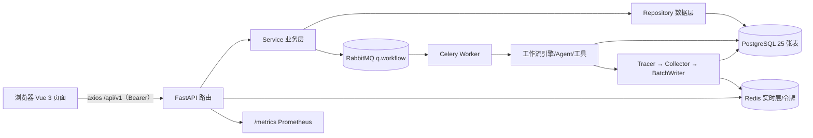

前端不直连数据库，也不自行计算统计指标；所有列表、过滤、分页、聚合都在后端完成。

---

## 1. 首次进入：登录与会话

### 1.1 用户操作

1. 打开 `http://127.0.0.1:5173`（开发态 Vite；代理到 `http://127.0.0.1:8000`）。
2. 未登录会被路由守卫送到 `/login`，并带上 `?redirect=原路径`。
3. 输入邮箱与密码（演示账号由 `seed_users.py` 创建，密码来自 `SEED_PASSWORD`）。
4. 登录成功后回到原路径；若没有原路径则进入 `/`。

### 1.2 链路

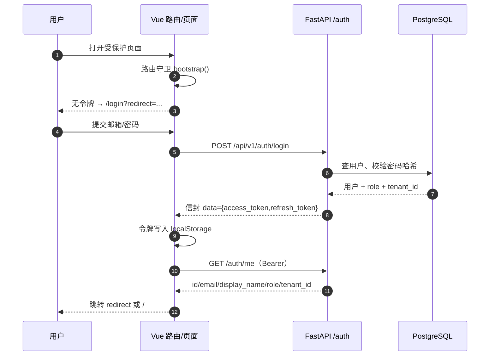

### 1.3 作用与细节

- **只持久化令牌**：`access_token` 与 `refresh_token` 存在 `localStorage`；
  `user` 对象只在内存，刷新页面通过 `/auth/me` 恢复。
- **统一信封**：后端返回 `{code, message, data, trace_id}`；`code=0` 才是成功。
  axios 响应拦截器自动解包 `data`，业务码非 0 时抛 `ApiError`。
- **401 自动刷新**：任意请求 401 时，客户端用 refresh token 换新令牌并重放原请求；
  并发的多个 401 共享同一次刷新，避免刷新风暴。登录/刷新接口自身的 401 不参与重试，
  这样“邮箱或密码错误”能直接显示。
- **刷新失败**：清空令牌并派发 `auth:unauthorized`，应用统一跳回登录页。
- **主动退出**：调用 `POST /auth/logout`（尽力而为），无论后端是否成功都清理本地令牌。
- **权限**：登录后角色进入 Pinia；路由 `meta.roles` 决定能否进入，导航按角色裁剪。
  无权访问统一落到 `/403`，未知路径落到 404。
- **租户**：令牌携带租户上下文，后端查询自动限定当前租户；前端不需要传 tenant_id。

---

## 2. 控制台骨架：导航、角色裁剪与占位页

### 2.1 链路

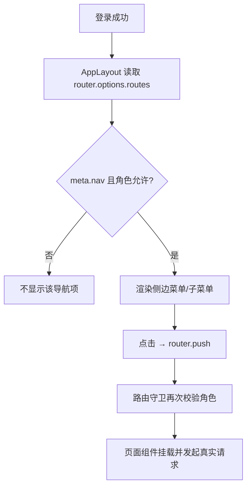

### 2.2 作用

- 侧边导航不是手写清单，而是从路由表推导：`meta.nav`、`meta.icon`、`meta.roles`、
  `meta.activeMenu`。因此新增页面只改路由即可出现在导航中。
- 顶部显示当前角色标签、显示名和退出按钮；显示名优先 `display_name`，否则邮箱。
- 占位页（概览、业务 Agent、节点、设备、事件、知识库、系统设置）明确标注“模块待接入”，
  并写明“不展示模拟统计、模拟列表或占位图表”。对应后端接口已存在，但本期前端未接。
- 可观测模块有二级标签页：概览 / Trace 查询 / 工具分析 / 模型分析 / Agent 分析 /
  提示词 / 设置（仅 admin）。标签用最长路径前缀匹配，进入 Trace 详情仍高亮“Trace 查询”。

---

## 3. 工作流：从列表到编辑器

### 3.1 列表页 `/workflows`

用户操作：

1. 进入页面，按 `page/size` 拉取 `GET /workflows`，展示名称、状态（草稿/已发布）、
   当前版本、最近一次运行摘要。
2. operator/admin 看到“新建工作流”；viewer 只读。
3. 点击行或“编辑”进入 `/workflows/:id`。

链路细节：

- 分页与“过期响应丢弃”：每次加载递增令牌，快速翻页时旧响应不会覆盖新结果。
- 空列表时展示真实空态；有写权限时给出“新建第一个工作流”的引导。
- 新建弹窗只收集名称/描述，创建时提交 `dsl: {nodes: [], edges: []}`，
  成功后直接进入编辑器继续编排。

### 3.2 编辑器 `/workflows/:id`

编辑器同时持有两份“版本概念”：

- **已发布版本** `current_version`：运行真正执行的快照。
- **草稿版本** `draft_version`：编辑器保存的最新草稿；可以比已发布版本更新。
- 页面加载 `GET /workflows/{id}`，返回当前草稿 DSL（没有草稿时回退已发布版本），
  然后转成 Vue Flow 的节点/边；缺失坐标的节点按 start 出发的层级自动布局。

#### 节点类型（6 种）

| 类型 | 作用 | 关键字段 | 执行时发生什么 |
|---|---|---|---|
| start | 流程唯一入口 | 无 | 输出 = 运行输入；节点 span |
| agent | 调用 Agent | `agent`（名称）、`input` 表达式、`max_retries` | 按名称查同租户 active Agent，调用 `run_agent`，产生 agent span；LLM 调用写 `llm_calls` |
| tool | 调用工具 | `tool`（tool_id）、`input` 表达式、`max_retries` | 通过工具注册表执行，产生 tool span，写 `tool_calls`；幂等键 `run_id:node_id` |
| condition | 表达式分支 | `expression` | 求值 true/false，后继边按 `when` 分流 |
| approval | 人工审批 | `title`、`approvers`（角色数组）、`timeout_ms` | run/node 进入 `waiting_approval`，释放 worker，trace 保持开启 |
| end | 流程终点 | 无 | 单前驱时透传其输出；节点 span |

#### 画布即时校验（前端）

- start 只能有一个；start 不允许入边；end 不允许出边；节点不能连自己。
- condition 必须从“是/否”分支发起，两个分支不能指向同一节点；其他节点不能使用分支。
- 普通连线不能重复。非法操作只提示，不写入图。

#### 保存 / 校验 / 发布

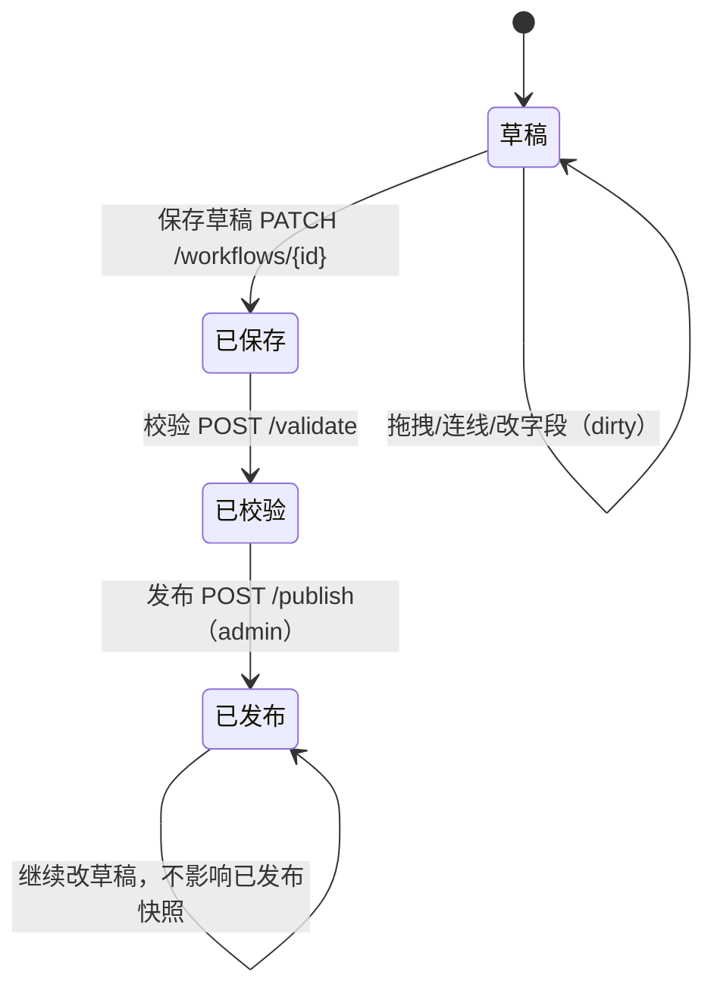

- **保存草稿**：`PATCH /workflows/{id}` 提交完整 DSL；成功后记录快照，`dirty` 变 false。
- **校验**：`POST /workflows/{id}/validate` 提交当前画布 DSL。非法也返回 200，
  由 `valid/errors/warnings/node_count/edge_count/entry_node/end_nodes/topological_order`
  表达。校验器检查结构、节点字段、start/end 约束、条件分支、DAG/可达性，
  并在结构无错误时查询同租户 active Agent / enabled Tool（Agent 或工具不存在会报错）。
  点击问题可定位到对应节点。
- **发布**：admin 才显示发布按钮。前端先保存草稿，再调用 `POST /publish`；
  后端用 `assert_valid` 再校验一次，非法返回 400，前端自动拉取校验明细。
  发布生成不可变版本 `vN`，`current_version` 前进；历史版本保留。
- **试跑**：只有“已发布”才能试跑。若画布有未保存修改或草稿版本更新，
  弹窗会明确提示“本次试跑使用已发布版本 vN”，不会偷偷执行草稿。
- **离开保护**：有未保存修改时离开会弹确认框，避免误丢编辑。

#### 权限

- 编辑/保存/试跑：operator、admin。
- 发布：admin。
- 只读角色仍可查看画布、点击节点查看字段、执行校验。

---

## 4. 试跑：运行是怎么被创建和执行的

### 4.1 编辑器内操作

1. 点击“试跑”，输入 JSON 对象（空输入视为 `{}`；非对象立即阻止）。
2. 前端 `POST /workflows/{id}/runs`，请求体 `{input}`。
3. 返回 `pending` 运行详情；页面展示运行 ID 与提示，不在这里轮询执行进度。
4. 用户可跳到 `/runs/:id` 或运行列表查看后续状态。

### 4.2 完整链路

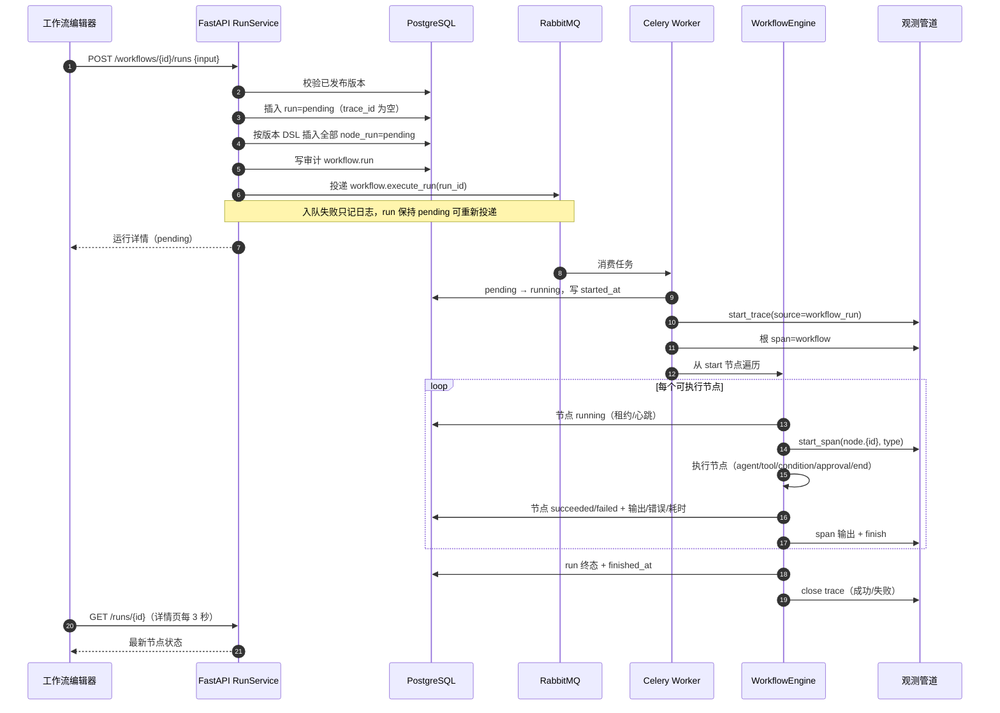

### 4.3 执行语义

- **状态机**：`pending → running → succeeded / failed / timeout / cancelled`；
  审批时 `waiting_approval` 是暂停态，不是终态。
- **节点状态**：`pending / running / waiting_approval / succeeded / failed / skipped`。
- **顺序**：按图的拓扑推进；condition 根据表达式结果选择 `when=true/false` 的出边。
- **重试**：agent/tool 节点按 `max_retries` 重试；每次 attempt 产生独立 span，
  但分析页只统计 `attempt=1` 的逻辑执行，避免重试放大成功率分母。
- **超时**：节点 `timeout_ms` 控制；审批默认 24 小时，可按节点覆盖。
- **取消**：operator/admin 可在非终态调用 `POST /runs/{id}/cancel`；
  引擎每步前重读状态，看到取消立即停止，不覆盖取消写入的终态。
- **僵尸/陈旧运行**：scheduler 周期扫描非终态且心跳过期的运行并重新投递；
  已成功/跳过的节点不重跑，遗留的 running 节点用 attempt+1 重试。
- **观测失败隔离**：tracer/span 的任何异常都被吞掉并降级为 Null 句柄，
  节点照常执行、运行结果不受影响。监控永远不反向打断业务。

---

## 5. 审批节点：暂停、决定、恢复

### 5.1 链路

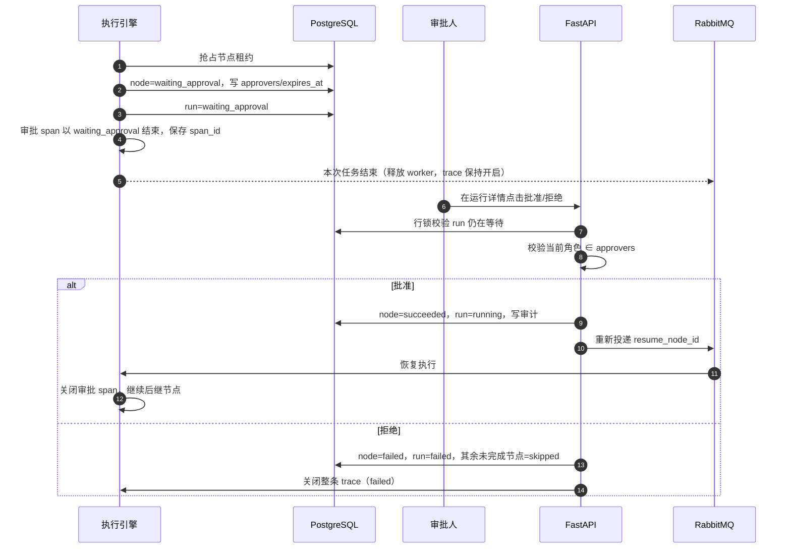

### 5.2 作用与细节

- **审批人是角色**：`approvers` 是角色数组（如 `["admin","operator"]`）。
  管理员不是隐式审批人，必须显式列入；否则后端返回 403。
- **审批卡片**：运行详情只对 `waiting_approval` 节点展示审批卡；
  批准/拒绝可填意见，空意见不写空白字符串。
- **审计**：批准/拒绝都写 `audit_logs`（动作 `workflow.approve` / `workflow.reject`）。
- **超时**：scheduler 调用 `expire_waiting_approvals`，超时运行收口为失败并关闭 trace。
- **恢复不重跑**：已成功的审批节点不会再次执行；引擎只关闭审批 span 并从后继继续。
- **前端**：运行详情每 3 秒轮询，审批后立即用响应整体替换页面数据；
  审批失败只显示错误，不伪造状态。

---

## 6. 运行详情：节点、报告、证据与 Trace

### 6.1 页面组成

- **顶部**：运行 ID、工作流名/版本、状态、触发方式、耗时、Trace 是否有真实记录。
- **节点时间线**：每个节点一行，显示类型、状态、attempt、开始/结束、错误；
  点击节点在右侧看输入/输出/审批详情。
- **运行报告**：从 `run.output` 提取报告（Markdown），用 `MarkdownBlock` 安全渲染。
- **证据抽屉**：从运行输出与所有节点输出递归收集真实证据引用，按 `type:ref` 去重；
  不生成占位证据。
- **Trace 抽屉**：展示该运行的 span 树；点击节点 span 可聚焦；
  列表页的“已采集/仅有 trace_id”也会区分 traces 表是否真有记录。
- **操作**：取消（operator/admin、非终态）；批准/拒绝（角色必须匹配）。

### 6.2 轮询与一致性

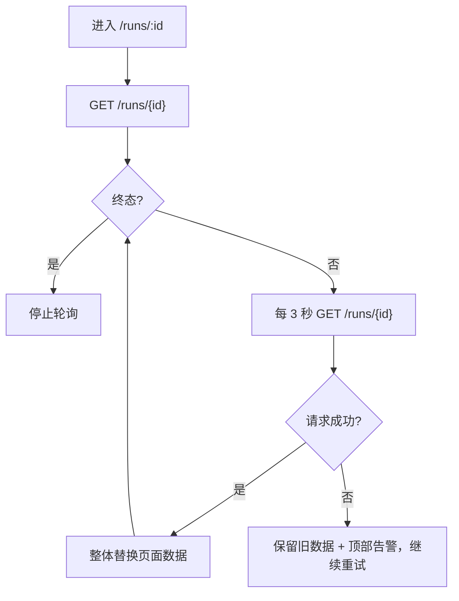

- 运行级实时推送本期没有 WebSocket；页面明确使用 3 秒轮询。
- 每次加载/审批/取消都会递增状态版本号，在途轮询结果若已过期会被丢弃。
- 轮询失败不清空页面，只显示“自动刷新失败，已保留上次数据”。
- 页面不做乐观更新：审批/取消成功后才用后端返回的详情替换。

---

## 7. 观测数据链路：一条 Trace 是怎么产生的

### 7.1 埋点位置

| 业务动作 | 观测记录 |
|---|---|
| 工作流运行 | `traces` 一条（source=`workflow_run`）+ 根 `spans`（type=`workflow`） |
| 每个工作流节点 | `spans` 一条，type 为节点类型；attempt 递增 |
| Agent 执行 | agent `span`（type=`agent`，带 agent_id/version） |
| LLM 调用 | `llm_calls`（provider/model/usage/cost/请求响应/错误）挂在所属 span |
| 工具调用 | tool `span` + `tool_calls`（参数/结果/权限/重试/耗时） |
| RAG 检索 | retrieval `span` + `retrieval_records`（召回/重排/分数） |
| Prompt 执行 | `prompt_executions`（模板/版本/hash/状态/trace 关联） |
| 审批 | approval `span` + trace 事件 `approval_requested` |
| 生命周期节点 | `trace_events`（按 sequence_number 递增） |

### 7.2 写入管道

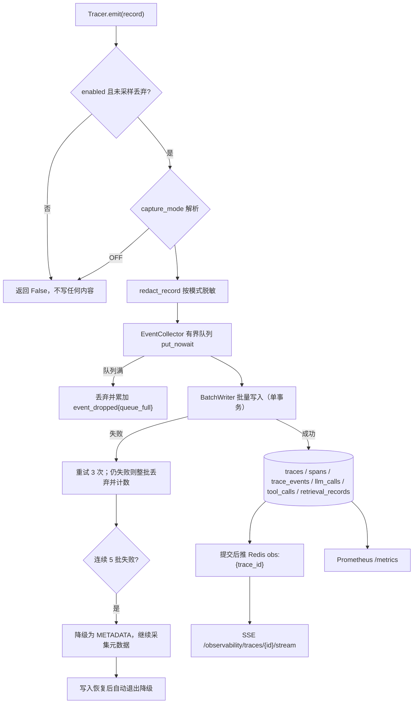

### 7.3 关键约定

- **采集模式**（`OBS_CAPTURE_MODE`）：
  - `OFF`：只存标识，不存任何内容；
  - `METADATA`：只存 prompt_hash 等元数据；
  - `REDACTED`（生产推荐）：敏感键替换 `***`，清理 Bearer / `sk-` / 手机号 / 身份证号；
  - `FULL`：原样保存，仅受控环境使用。
- **降级**：连续写失败进入 METADATA；这不是“停止监控”，而是减少内容字段，
  保证管道恢复后继续有数据。
- **失败隔离**：采集队列满、写库失败、Redis 推送失败都不会让业务请求/节点执行失败。
  写库失败只影响观测数据完整性，由指标与降级状态暴露。
- **不估算**：provider 没给 token/cost 就写 `NULL`，页面显示“未上报”；
  绝不写 0、绝不用价格表反推。
- **实时层**：Redis 只做转发，PG 是事实来源；SSE 先补发 PG 历史事件，再转发 Redis，
  15 秒心跳，收到 `trace.close` 后以 done 收尾。
- **本期前端没有消费 SSE**：Trace 详情是“进入页面时并行拉取”，运行详情是 3 秒轮询。
  SSE 接口已实现并可用，但页面未接 EventSource（后续可接）。

---

## 8. 可观测概览 `/observability`

### 8.1 操作

1. 进入页面默认“近 24 小时”；可切近 1 小时 / 7 天 / 30 天。
2. 切换后重新请求 `GET /observability/analytics/overview`。
3. 全部卡片、趋势、分布都来自同一次响应；页面不做本地聚合假数据。

时间窗规则：

- 不传参数 → 后端默认最近 24 小时；
- 只传 `start_from` → 结束时间取当前时刻；
- 窗口 ≤ 72 小时按小时分桶，否则按天分桶。

### 8.2 指标口径

| 卡片 | 口径 |
|---|---|
| Trace 总数 | 窗口内 `traces` 行数（含 running） |
| Trace 成功率 | succeeded / 已结束（排除 running）；无已结束显示未上报 |
| Trace P95 | `duration_ms` 的 95 分位；无值显示未上报 |
| Span 总数 | 窗口内 `spans` 行数（含各 attempt） |
| Agent 执行数 | `span_type='agent'` 且 `attempt=1` |
| 工具成功率 | 已结束逻辑 tool span 中 succeeded 占比 |
| 权限拒绝数 | `tool_calls.permission_result='denied'` |
| LLM 调用数 | 窗口内 `llm_calls` 行数 |
| Token 总量 | `sum(total_tokens)`；全缺 usage 显示未上报 |
| 总成本 | `sum(cost)`；缺价只计入“缺价次数”，并显示价格覆盖模型数 |

图表：Trace 趋势（总数/成功/失败）、延迟趋势（P50/P95）、Token 趋势（总/缓存）、
模型分布、Agent 分布、工具分布、错误 Top10、最慢 Trace Top10。

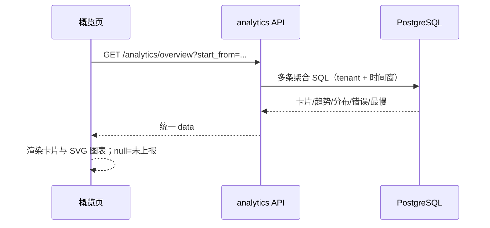

---

## 9. Trace 查询 `/observability/traces`

### 9.1 操作

1. 在筛选栏填写状态、trace_id 前缀、来源、用户、Agent、模型、工具、时间范围、
   最小耗时、失败/慢查询等条件。
2. 点击“查询”后条件写入 URL；页面监听 URL 变化重新请求。
3. 翻页、刷新、分享链接、浏览器前进/后退都还原同一组条件。
4. 点击行进入 `/observability/traces/:traceId`。

### 9.2 URL 契约

- URL 是筛选条件的唯一来源；表单只是“尚未提交的草稿”。
- 空字段与 `page=1` 不写入 URL，保持链接可读。
- `failed=true` 表示终态失败（`failed/timeout/cancelled`），`slow=true` 表示
  `duration_ms >= 3000`；传 false 表示不过滤。
- `agent_id/model/tool` 通过关联记录匹配 trace（存在对应 span / llm_call / tool_call），
  不产生重复行。

### 9.3 性能与展示

- 每页 100 条，固定行高 + 窗口化渲染，避免一次渲染整页 DOM。
- 状态、耗时、Token、成本缺失都显示“未上报”，不显示 0。
- 从工具/模型/Agent 分析页点击行会带着 `tool/model/agent_id` 跳到本页，
  直接得到该维度的 Trace 列表。

---

## 10. Trace 详情 `/observability/traces/:traceId`

### 10.1 三栏布局

- **左：Span 树**（树形层级，展示名称、类型、状态、耗时）。
- **中：时间线**（按开始/结束时间可视化各 span 的相对位置）。
- **右：Inspector**（选中 span 的详情）。

### 10.2 加载链路

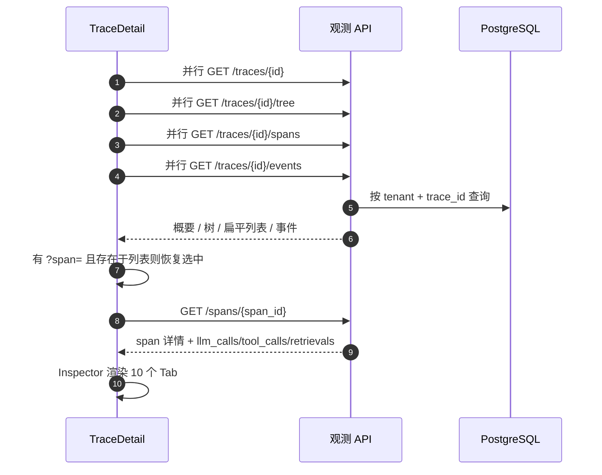

- 四个请求任一失败视为整页失败，清空旧数据，避免混入上一条 Trace。
- 选中 span 写回 `?span=`，刷新页面仍停留在同一个 span。
- Trace ID 可一键复制；复制失败明确提示，不静默。
- 没有 span 时展示真实空态，并说明“不会生成占位节点或模拟时间线”。

### 10.3 Inspector 的 10 个 Tab

| Tab | 内容 |
|---|---|
| 概览 | 类型、状态、attempt、开始/结束、耗时、节点/Agent/工具标识 |
| 输入 | span 记录的输入 JSON |
| 输出 | span 记录的输出 JSON |
| 模型 | 该 span 下的 `llm_calls`：provider/model、usage、cost、finish_reason |
| 工具 | 该 span 下的 `tool_calls`：参数、结果、权限、重试、错误 |
| 检索 | `retrieval_records`：召回/重排文档、分数 |
| Prompt | 模板标识、版本、prompt_hash、变量/渲染消息（受采集模式影响） |
| 事件 | `trace_events`：审批请求、interrupt 等，按序号 |
| 错误 | 错误码/错误信息/堆栈（若记录） |
| 元数据 | 其余 metadata 键值，JSON 查看器 |

所有内容都来自接口；被脱敏或被采集模式裁掉时展示空/不可用，不补造。

---

## 11. 工具 / 模型 / Agent 分析

三个页面结构一致：时间范围（1h/24h/7d/30d）+ 汇总卡 + 明细表 + 行点击跳 Trace。

### 11.1 工具分析 `/observability/tools`

- 接口：`GET /observability/analytics/tools`。
- 口径：逻辑 tool span（`attempt=1`）；汇总成功率按调用数加权，P95 取各工具最大值
  （分位数不能相加）。
- 行点击：带 `tool=<tool_id>` 跳到 Trace 查询。

### 11.2 模型分析 `/observability/models`

- 接口：`GET /observability/analytics/models`。
- 维度：`provider + model`（同名模型可能来自不同 provider，行键必须带 provider）。
- 成本：某行 `cost=null` 显示“费用不可用”；部分调用缺价显示“部分未配价”；
  汇总只在有价行上求和，全部缺价则汇总也为 null。
- 行点击：带 `model=<model_name>` 跳到 Trace 查询。

### 11.3 Agent 分析 `/observability/agents`

- 接口：`GET /observability/analytics/agents`。
- 口径：逻辑 agent span（`attempt=1`）；成功率按执行数加权，P95 取最大值。
- 行点击：带 `agent_id=<id>` 跳到 Trace 查询；agent_id 为空不构造假链接。

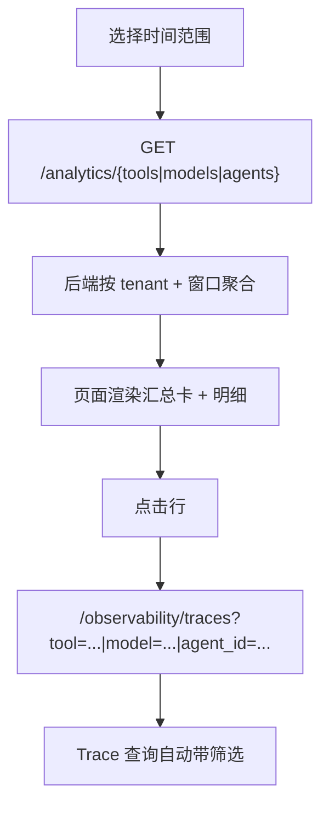

---

## 12. 提示词管理 `/observability/prompts`

### 12.1 数据模型

- 一个模板（`prompt_templates`）包含多个版本（`prompt_versions`）。
- **版本内容不可变**：新增版本只能追加；发布/回滚只切换 `active_version`，
  不修改任何历史版本内容。
- 模板列表显示当前发布版本或“未发布”。

### 12.2 操作与权限

| 操作 | 权限 | 接口 |
|---|---|---|
| 查看模板/版本/执行历史 | 所有登录角色 | `GET /prompts`、`GET /prompts/{id}`、`GET /{id}/executions` |
| 新建模板 | admin | `POST /prompts` |
| 追加版本 | admin | `POST /prompts/{id}/versions` |
| 发布版本 | admin | `POST /prompts/{id}/publish` |
| 回滚版本 | admin | `POST /prompts/{id}/rollback` |
| 预览/真实执行 | 预览所有登录角色；真实执行 admin/operator | `POST /prompts/{id}/playground` |

### 12.3 页面链路

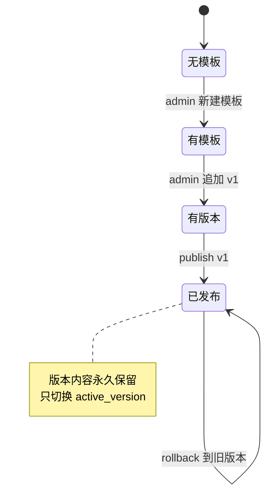

1. 左侧模板分页列表；选中后右侧加载模板详情 + 执行历史。
2. 版本区可选中任意版本查看 system/user prompt、变量 schema、changelog。
3. “对比”选择两个版本，用 `PromptDiff` 在前端做文本差异展示。
4. 发布/回滚有确认框，明确“只切换当前发布版本，不改历史内容”。
5. 执行历史每条可点 Trace（若该次执行记录了 trace_id），进入 Trace 详情。
6. “打开 Playground”带着 `?template=<id>` 跳到 Playground。

---

## 13. Prompt Playground `/observability/prompts/playground`

### 13.1 两种模式

- **预览（execute=false）**：只做变量渲染，返回 messages、prompt_hash、版本；
  不调用 LLM、不写 `prompt_executions`、不产生 trace。
- **真实执行（execute=true）**：admin/operator 才可；渲染成功后调用 LLM，
  开一条 `source="playground"` 的 trace，prompt span 记录模板/版本/hash，
  LLM 调用写 `llm_calls`，并写 `prompt_executions`；返回 trace_id/span_id/response。
  渲染失败（schema/模板变量）直接返回预览 + `response=null`，不触达 LLM。
  LLM 超时/错误仍返回 200 + `status="llm_error"`，不会把 5xx 甩给页面。

### 13.2 链路

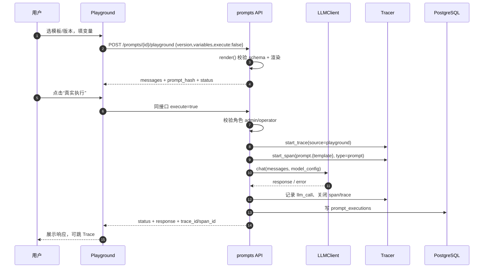

### 13.3 变量与模型

- 变量键来自版本 `variables_schema.properties`；必填键带 `*`。
- 表单与 JSON 双向配合：改表单同步到 JSON；直接编辑 JSON 不会被表单反向覆盖。
- 非法 JSON / 非对象立即阻止提交。
- 模型可选 `model_config_id`（同租户）；不选则由执行侧默认。
- 默认 `LLM_MODE=mock`（fixtures），真实模式需要环境变量与 Key；
  页面不会伪造“真实调用成功”。

---

## 14. 可观测设置 `/observability/settings`

### 14.1 定位

- 仅 admin 可访问；**只读**，本期没有持久化写入接口。
- 数据来自当前进程真实配置与租户内真实统计。

### 14.2 展示内容

| 区块 | 含义 |
|---|---|
| 当前采集模式 | 来自 `OBS_CAPTURE_MODE`（OFF/METADATA/REDACTED/FULL） |
| 缺价模型组合 | 租户内 `cost IS NULL` 的 provider/model 组合（最多 20 条） |
| 脱敏规则数 | bearer / sk- / 手机号 / 身份证号等清理规则 |
| 保留期 | traces/spans/llm_calls/tool_calls/retrieval/prompt_executions/audit 的固定天数 |
| 采集模式说明 | 四种模式各自保存什么 |

### 14.3 “修改采集模式”按钮

- 不会调用任何写接口，也不会改本地展示值。
- 只弹出确认并生成变更步骤：改环境变量 → 重启 api → 重启 worker → 回页面刷新确认。
- 这是有意的安全设计：采集模式影响全进程行为，不做运行时热改。

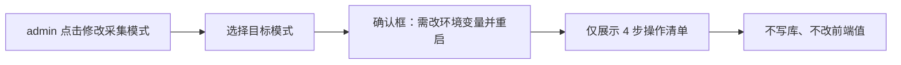

---

## 15. 占位模块与能力边界

| 模块 | 现状 | 说明 |
|---|---|---|
| 概览 `/` | 占位 | `GET /dashboard/summary` 已实现，页面待接 |
| 业务 Agent 管理 `/agents` | 占位 | Agent CRUD/发布/试跑接口已实现 |
| 节点/设备/事件/知识库 | 占位 | 各自查询/操作接口已实现 |
| 系统设置 `/settings` | 占位 | 用户与审计接口已实现 |
| Trace 实时推送 | 后端已实现 | SSE 端点可用；前端本期未接，详情用拉取、运行用 3 秒轮询 |
| 回放 / 评测闭环 | P8 | 第 26 张表 `evaluation_records` 与回放不在本期 |
| 大包体积 | 已知 | 前端主 chunk 约 1.6 MB，构建有体积告警 |

占位页明确写明“不展示模拟统计、模拟列表或占位图表”，这是刻意的诚实边界。

---

## 16. 三个典型端到端场景

### 16.1 从零到一条可观测 Trace

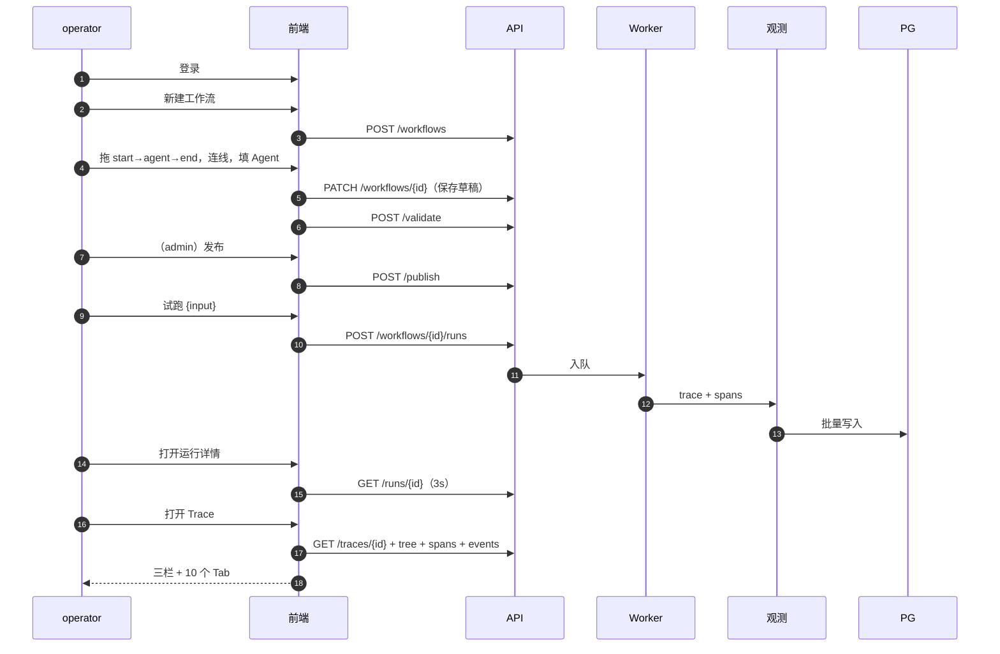

### 16.2 审批型流程

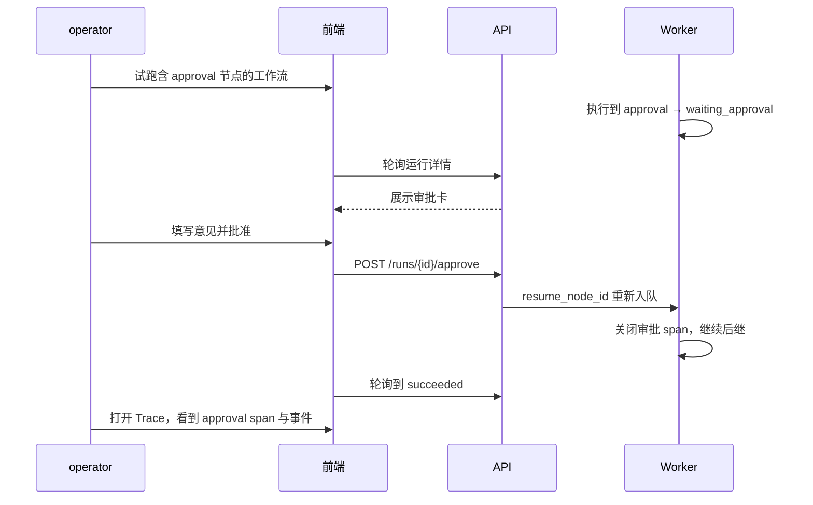

### 16.3 Prompt 优化闭环

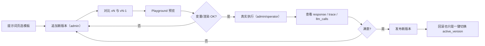

---

## 17. 横切机制与排错索引

### 17.1 统一约定

- **响应信封**：`{code, message, data, trace_id}`；`code=0` 成功。
- **错误展示**：页面只展示后端 `message`，不把 axios/堆栈细节暴露给用户。
- **加载/错误/空态**：统一用 `AsyncState`，失败可重试；空态是真实空态。
- **不伪造数据**：缺 token/cost/耗时一律 null → “未上报”；没有 trace 就没有占位节点。
- **租户隔离**：所有查询强制租户；跨租户返回 404，不泄露“存在但无权”。
- **观测是旁路**：任何采集/写入/推送失败都不影响业务执行。

### 17.2 症状 → 先看哪里

| 症状 | 先检查 |
|---|---|
| 登录 401 | 账号密码、`seed_users.py`、后端日志 |
| 请求 401 后跳登录 | refresh token 是否过期、`/auth/refresh` 日志 |
| 页面 403 | 当前角色是否满足路由/接口要求 |
| 工作流无法发布 | 是否 admin；先点“校验”看 errors |
| 试跑一直 pending | RabbitMQ/worker 是否运行；scheduler 是否重投 |
| 运行一直 waiting_approval | 审批人角色是否在 approvers；是否已超时 |
| 运行有 trace_id 但 Trace 打不开 | traces 表是否真有记录（列表显示“仅有 trace_id”） |
| 页面没有数据 | 时间窗、筛选条件、租户；不是“数据被前端过滤掉了” |
| 成本显示不可用 | provider 未配价；这是正确行为，不是 bug |
| Trace 没有 Span | 采集模式 OFF/采样丢弃/写入失败/降级；看 `/metrics` 与 worker 日志 |

---

## 18. 页面 → 接口速查

| 页面 | 主要请求 |
|---|---|
| 登录 | `POST /auth/login`、`GET /auth/me`、`POST /auth/refresh`、`POST /auth/logout` |
| 工作流列表 | `GET /workflows`、`POST /workflows` |
| 编辑器 | `GET /workflows/{id}`、`PATCH /workflows/{id}`、`POST /validate`、`POST /publish`、`GET /versions`、`POST /runs`、`GET /agents`、`GET /tools` |
| 运行列表 | `GET /runs?page&size&status` |
| 运行详情 | `GET /runs/{id}`、`POST /cancel`、`POST /approve`、`POST /reject`、`POST /observability/traces/{id}/...` |
| 可观测概览 | `GET /observability/analytics/overview` |
| Trace 查询 | `GET /observability/traces` |
| Trace 详情 | `GET /traces/{id}`、`/tree`、`/spans`、`/events`、`GET /spans/{span_id}` |
| 工具分析 | `GET /observability/analytics/tools` |
| 模型分析 | `GET /observability/analytics/models` |
| Agent 分析 | `GET /observability/analytics/agents` |
| 提示词 | `GET/POST /observability/prompts`、`GET /{id}`、`GET /{id}/executions`、`POST /{id}/versions`、`POST /publish`、`POST /rollback` |
| Playground | `POST /observability/prompts/{id}/playground` |
| 可观测设置 | `GET /observability/settings` |

所有接口都以 `/api/v1` 为前缀，均需 Bearer 令牌；权限按上表与角色矩阵执行。
